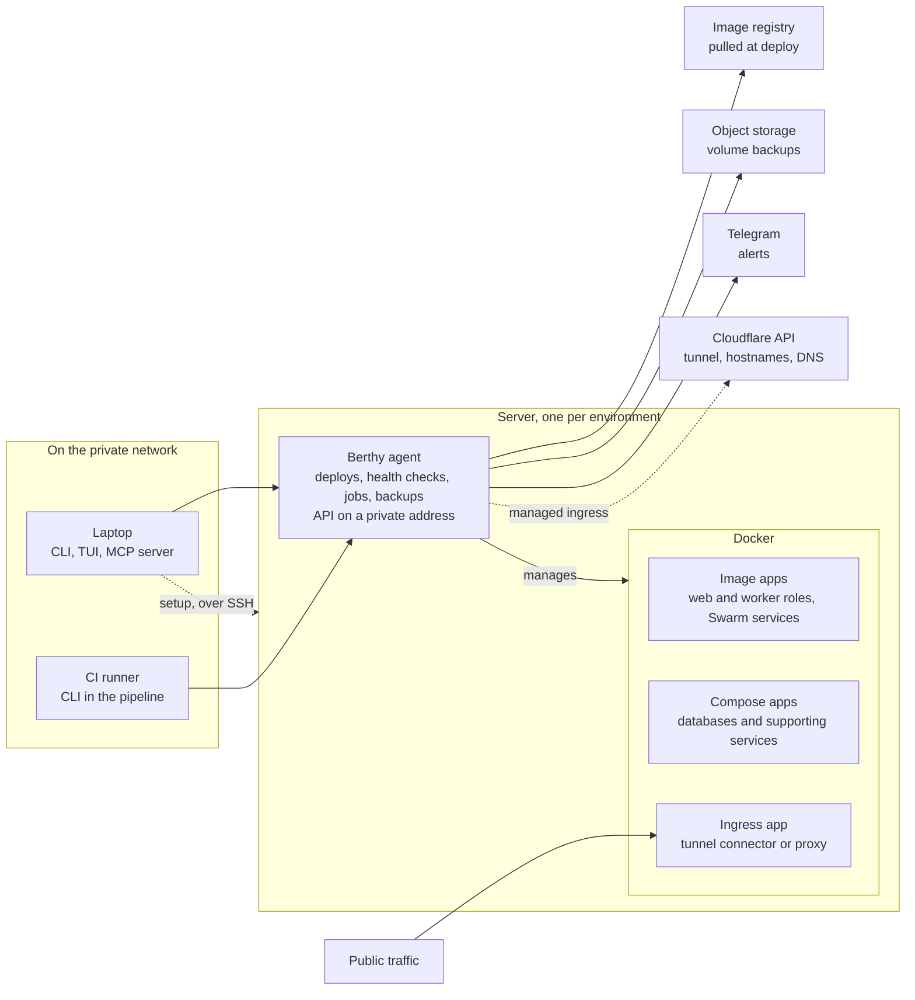

# Berthy v1 spec

Last updated: 2026-11-15

## Summary

Berthy is a small deployment and operations agent for Docker servers. It deploys image and Compose apps, shows live logs and metrics, and runs health checks with alerts. It can run commands in app containers on a schedule and back up Docker volumes to object storage. People use the CLI or terminal UI. AI agents use the CLI or MCP server.

It is built for a small team that runs a web application on its own servers: one server per environment, with an optional three-server cluster.

v1 is done when an environment can be run entirely through Berthy, with deploys, monitoring, alerts, scheduled jobs and backups all handled by it.

"Berthy" is a working name.

## Scope

v1 is deliberately small. It covers what it takes to run a web application and its supporting services on one server per environment, and nothing else.

**In scope**

- Deploy Docker image apps and Compose apps to one server per environment.
- Preparing a server with one command: `berthy setup` checks or installs Docker, turns on Swarm mode and installs the agent, over SSH or on the server itself.
- Optional managed ingress through Cloudflare Tunnel: Berthy creates the tunnel, runs its connector, and keeps public hostnames and DNS records in step with the manifest.
- Image deploys with no downtime: new version starts first, must pass its health check, and rolls back automatically if it does not.
- Live logs per app.
- Live metrics per server and per container: CPU, memory, disk space, Docker disk usage, block I/O and network I/O.
- Health checks with alerts to Telegram.
- Cron jobs that run commands inside image app or Compose service containers.
- Opt-in scheduled backups of app volumes to S3-compatible object storage, with a restore command.
- Every function available from the CLI with JSON output, and through MCP.
- A small footprint: one binary, no database server. The target is under 30 MB of resident memory for the agent, to be measured in phase 1.
- A deployment model that extends to a three-server cluster without redesign.
- Adopting apps that another deployment tool already runs, without recreating them.

**Out of scope for v1**

- A reverse proxy and certificates. Berthy ships no proxy; public traffic enters through a tunnel connector or proxy that runs as an app. Berthy can manage a Cloudflare Tunnel for this, and Cloudflare serves the certificates. Any other ingress is an ordinary app you configure yourself.
- Cloudflare settings beyond the tunnel, its hostnames and their DNS records, such as access policies and firewall rules.
- Building and pushing images. CI does both; Berthy deploys only images that already exist in a registry.
- Database provisioning and Postgres high availability.
- Users, teams and roles beyond token scopes.
- Templates and preview environments.
- A web UI.
- Long-term storage of logs and metrics. Berthy exports them over OpenTelemetry to a backend of your choice.
- Server provisioning and hardening beyond what `berthy setup` does. Creating the server, its users, its firewall and its private network stays with your provisioning.

## Architecture

Berthy is one static Go binary that runs in four modes, with an agent on each server and no central server between them.



The agent is the only component clients talk to. It drives Docker and reaches the registry, object storage and Telegram itself; public traffic enters only through the ingress app.

The one exception is `berthy setup`. It reaches a server over SSH to install the agent, because there is no agent to talk to yet. See Server setup.

| Mode | Runs on | Job |
| --- | --- | --- |
| Agent | Each server, as a systemd service | Talks to Docker, runs deploys, health checks, scheduled jobs and backups, and serves the API |
| CLI | Laptops and the CI runner | Sends commands to an agent; prints text or JSON |
| TUI | Laptops | Live view of apps, logs and metrics |
| MCP server | Wherever an AI agent runs | Exposes the same operations as tools |

### Decisions

- **One agent per server, no gateway.** Each environment's agent is self-sufficient. The CLI keeps one named context per environment and talks to the right agent directly.
- **Swarm mode is always on, even with one node.** Image apps run as Swarm services, which gives rolling updates and rollback for free, and the same model extends to a cluster.
- **Private network only.** The agent listens on one configured address, which should belong to a private network such as a WireGuard-based VPN. It never listens on all interfaces.
- **No bundled proxy.** Ingress is an app on the shared Docker network that routes to other apps by service name. With managed ingress, Berthy runs a Cloudflare Tunnel connector as that app and configures its routes; see Managed ingress with Cloudflare Tunnel.
- **A systemd service, not a container.** The agent keeps reporting when Docker itself is unhealthy. `berthy setup` installs it.
- **SSH for setup only.** Installing the agent is the single operation that uses SSH. Every other command goes through the agent's API, so Berthy stores no SSH credentials and day-to-day access needs no shell on the server.
- **HTTP and JSON API.** Streams (logs, metrics, deploy progress) use server-sent events, so `curl` and AI agents can read them without a client library.
- **Go.** Docker's client library, the Compose tooling and the strongest terminal UI libraries are all written in it.

### Where state lives

| State | Lives in |
| --- | --- |
| Desired configuration, including apps, checks, jobs and backups | Git, as a manifest in the application's repository |
| What is running | Docker; labels mark what Berthy manages |
| Secrets, deploy history, audit log, job status and backup records | One SQLite file on the server, secrets encrypted |
| Log and metric history | An OpenTelemetry backend, if one is configured |
| Volume backups | Object storage |
| Tunnel, public hostnames and DNS records, with managed ingress | Cloudflare; the manifest says what they should be |

The agent keeps a copy of the last applied manifest so schedules keep running between deploys. Git remains the source of truth.

## Application model

Berthy manages two kinds of application: image apps for stateless services and Compose apps for everything that holds data or supports the stack.

|  | Image app | Compose app |
| --- | --- | --- |
| Source | An image reference in a container registry | A Compose file from the repository at a given commit |
| Runs as | A Swarm service | A `docker compose` project on one named server |
| Used for | Web services and background workers | Databases, caches, telemetry backends, the ingress app |
| Update | Rolling: new starts first, gated on its health check, automatic rollback | Only changed services are recreated |
| Replicas | One or more | One per service |
| Ports | None published; reached by service name on the shared network | May bind a port to a private address |

### Rules

- **Roles.** An image app can define several roles that run the same image with different commands, such as `web` and `worker`. Each role has its own replica count, resources and health check, so web replicas can scale without multiplying job workers. An app can start with one role and split later.
- **Stateful apps are separate.** Deploying an image app never touches a Compose app. Restarting or recreating a Compose app marked `stateful` always takes an explicit command that names it.
- **Images are pinned by digest.** The agent resolves the tag to a digest at deploy time and records it. Rollback uses the recorded digest. Protected environments reject mutable tags such as `latest`.
- **Compose project names are explicit.** A Compose app runs under the project name `<project>-<app>` unless `project_name` sets another. Compose names volumes after the project, so the name must not change once an app holds data.
- **Adoption.** Existing services and Compose projects can be adopted by name without being recreated. See Adopting an existing deployment.
- **One shared network.** All apps join one attachable overlay network, so the ingress app resolves them by name. Its name is set in the manifest, so an existing network can be kept. `berthy setup` creates it when it does not exist.

## Configuration

All desired configuration lives in the application's repository as one base manifest plus one overlay per environment.

- `berthy.yml` holds what is common.
- `berthy.<environment>.yml` overrides it per environment: replicas, resources, schedules.
- Every deploy carries the merged manifest from the commit being deployed. Nothing is configured by hand on the server.

The examples in this spec use two environments named `dev` and `prod`. Names and values are placeholders.

```yaml
# berthy.yml
project: myapp
network: myapp

registries:
  ghcr.io:
    username: <user>
    password_secret: REGISTRY_TOKEN

apps:
  api:
    kind: image
    image: ghcr.io/<org>/<image>
    roles:
      web:
        replicas: 1
        port: 8080
        health:
          test: ["CMD", "curl", "-f", "http://localhost:8080/health"]
          interval: 15s
          timeout: 5s
          start_period: 30s
          retries: 3
    env:
      plain:
        LOG_LEVEL: info
      secret:
        - DATABASE_URL
        - JWT_SIGNING_KEY
    deploy:
      deploy_timeout: 120s
      drain_timeout: 30s
      retain: 5
    hooks:
      pre_deploy:
        - backup: main-db

  postgres:
    kind: compose
    file: deploy/postgres/docker-compose.yml
    stateful: true
    env:
      plain:
        POSTGRES_DB: myapp
      secret:
        - POSTGRES_PASSWORD
```

### Environments

An environment is one named target: its own server or cluster, agent, overlay, secrets and tokens.

- **No default environment.** Every command names its environment with `-e <name>`. A command that changes something and names no environment is rejected.
- **Protected environments.** An overlay can set `protected: true`, typically for production. A protected environment rejects mutable image tags, and holds changes requested by AI agents until a person approves them.

```yaml
# berthy.prod.yml
protected: true
```

### Health checks

A role's health check is a command run inside the container, with the same fields Docker uses.

| Field | Meaning | Example |
| --- | --- | --- |
| `test` | Command run inside the container; exit code 0 means healthy | `curl -f http://localhost:8080/health` |
| `interval` | Time between checks | 15s |
| `timeout` | Longest one check may take | 5s |
| `start_period` | Grace period after start; failures in it do not count | 30s |
| `retries` | Consecutive failures before the container is unhealthy | 3 |

- Durations are written as `15s`, not in nanoseconds.
- The check runs inside the container, so the image must contain the command.
- With the example values a container that never becomes healthy is marked unhealthy after about 75 to 90 seconds, inside the 120-second `deploy_timeout`.
- A healthy container is first noticed about one `interval` after start, so every deploy takes at least that long. An optional `start_interval` checks more often during the start period; confirm the installed Docker version supports it for Swarm services before using it.

### Environment variables

- **Plain** values are written in the manifest and reviewed like code.
- **Secret** values are listed in the manifest by name only. The values live in the agent's encrypted store and are set with `berthy secret set`.
- A deploy stops before changing anything if a named secret has no value.
- Values that differ between environments go in the overlays.
- Both kinds of app take the same `env` block. For a Compose app, Berthy writes the values into the project's environment file, where the Compose file reads them as `${NAME}`. Only the agent can read that file.
- Secrets are stored per environment. Other parts of the manifest refer to them by name as well: registries, backup destinations and telemetry.

### Registries

Image apps pull from any OCI registry. A private registry needs a credential, declared under `registries` with its password held as a secret.

```yaml
registries:
  ghcr.io:
    username: <user>
    password_secret: REGISTRY_TOKEN
```

- The credential should be read-only.
- The agent uses it to resolve tags to digests and to pull. It hands the credential to Swarm with the service, so every server in a cluster can pull.
- Compose apps use the same credential for images from a listed registry.
- A registry with no entry is pulled from anonymously.

### Checking a manifest

- `berthy config validate -e prod` checks the merged manifest without contacting a server.
- `berthy config show -e prod` prints the merged result with secret values hidden.

## Server setup

`berthy setup` takes a Linux server from a bare operating system to a running agent in one command, and deploys nothing.

```sh
berthy setup -e prod --host <user>@<server> --listen <private address>:<port>
```

It works in one of two ways.

| Where it runs | How | Used for |
| --- | --- | --- |
| From a laptop | `--host <user>@<server>` connects over SSH | Setting up a remote server by hand |
| On the server | `--local` runs the same steps directly | Provisioning tools and images that already carry the binary |

### What it does

1. **Connect.** Over SSH, or locally. The account must be root or able to use `sudo`.
2. **Check the server.** Linux with systemd, a supported CPU architecture, and the `--listen` address already assigned to the server. A server that already runs an agent for a different environment stops the run.
3. **Docker.** Confirm Docker Engine is installed, at a supported version, enabled at boot and running. If Docker is missing, install it with Docker's official install script. If it is stopped, start it.
4. **Swarm.** Turn on Swarm mode with the private address as the advertise address, unless the server is already a manager.
5. **Network.** Create the shared attachable overlay network named in the manifest, unless it exists.
6. **Agent.** Install the binary, create the `berthy` system user with access to Docker, write the agent's configuration, create the state directory and the encryption key, then install, enable and start the systemd service.
7. **First token.** Create one `admin` token and print it once. Add the environment to the CLI's configuration with the agent's address.
8. **Verify.** Call the new agent and run `doctor`. If the laptop cannot reach the private address, setup says so and runs the same check on the server instead.

It ends by printing the next steps: store a copy of the encryption key off the server, set the secrets, apply the managed ingress if the manifest declares one, and run the first deploy.

### Rules

- **It deploys nothing.** Setup never builds, pushes, pulls or starts an app. The first deploy is a separate `berthy deploy`, after the secrets are set.
- **Safe to run again.** Each step checks before it acts. A second run repairs what is missing and changes nothing else. It never replaces the encryption key, the tokens or the agent's state, and it never touches a running app.
- **It upgrades the agent.** Running setup with a newer CLI replaces the agent binary and restarts the service. Apps keep running while the agent restarts.
- **Existing Docker is left alone.** Setup does not upgrade or reconfigure a Docker installation it did not make. Docker older than the minimum supported version stops the run with a message. The minimum is Docker Engine 25.
- **Existing Swarm and network are kept.** A server that is already a manager keeps its Swarm. An existing network with the right name is used as it is; if it is not an attachable overlay, setup stops. A server that is a worker in another Swarm stops the run.
- **Same version as the CLI.** Setup installs the version of Berthy that runs it. A Linux CLI of the server's architecture uploads itself. Otherwise the server downloads the matching release and verifies its checksum. `--binary <path>` supplies a local build instead.
- **Dry run.** `--dry-run` connects, runs every check and prints what would change, without changing anything.
- **Scriptable.** `--json` reports each step and its result. A failed step exits non-zero and names the step.

### What it reads from the manifest

Run from the application's repository, setup reads two values from the merged manifest for the environment.

| Value | Used for | Without a manifest |
| --- | --- | --- |
| `network` | The shared network to create | `--network <name>` |
| `protected` | Marking the agent's environment as protected from its first start | `--protected` |

### Options

| Option | Meaning |
| --- | --- |
| `--host <user>@<server>` | Set up a remote server over SSH |
| `--local` | Set up the server the command runs on |
| `--listen <address>:<port>` | The private address the agent's API listens on. Required on the first run. |
| `--no-install-docker` | Stop if Docker is missing instead of installing it |
| `--binary <path>` | Install this Linux build of Berthy instead of the release that matches the CLI |
| `--key-file <path>` | Install a saved encryption key instead of generating one, when rebuilding a server |
| `--new-token` | Add another `admin` token, for when the first one is lost |

### What it leaves on the server

| Item | Location |
| --- | --- |
| Binary | `/usr/local/bin/berthy` |
| Agent configuration | `/etc/berthy/agent.json`, readable only by the agent's user |
| State and encryption key | `/var/lib/berthy`, readable only by the agent's user |
| Service | `berthy.service`, running as the `berthy` user in the `docker` group |

### What it does not do

- It does not create the server, its users, its firewall rules or its private network. The private address must exist before setup runs.
- It does not install or configure the VPN.
- It does not configure Docker's log rotation, storage driver or daemon options.
- It does not write a manifest. Start from the example in Configuration and check it with `berthy config validate`.

## Managed ingress with Cloudflare Tunnel

Berthy can own the whole path from a public hostname to an app: the tunnel, the connector that runs on the server, the hostname routes and the DNS records. It is optional, and it uses Cloudflare's API throughout.

Without it, publishing a new app means creating a tunnel in Cloudflare's dashboard, copying a command with a token to the server, then returning to the dashboard to point a hostname at the app's Docker service. With it, the hostname is one line in the manifest.

### Configuration

The base manifest turns managed ingress on. Hostnames usually differ by environment, so they go in the overlays.

```yaml
# berthy.yml
ingress:
  cloudflare:
    account_id: <account id>
    api_token_secret: CLOUDFLARE_API_TOKEN
    image: cloudflare/cloudflared:<version>
    replicas: 1
```

```yaml
# berthy.prod.yml
ingress:
  cloudflare:
    tunnel: myapp-prod

apps:
  api:
    roles:
      web:
        hostnames:
          - api.example.com
```

| Field | Meaning | Default |
| --- | --- | --- |
| `account_id` | The Cloudflare account that owns the tunnel | Required |
| `api_token_secret` | Name of the secret that holds the Cloudflare API token | Required |
| `image` | The connector image, pinned by digest at deploy like any image app | Required |
| `replicas` | Number of connectors | 1 |
| `tunnel` | The tunnel's name in Cloudflare | `<project>-<environment>` |
| `dns` | Whether Berthy creates DNS records | `true` |
| `hostnames`, on a role | Public hostnames that route to that role's `port` | None |

- **One tunnel per environment.** Every published app in the environment shares it.
- **A hostname belongs to one role.** The same hostname on two roles fails validation.
- **The target is worked out for you.** A hostname routes to `http://<project>-<app>-<role>:<port>`, the role's service name on the shared network. Swarm spreads requests across the role's healthy replicas.
- **The domain must already be in the Cloudflare account.** Berthy finds the zone from the hostname and does not add domains.

### What Berthy manages

| Item | How |
| --- | --- |
| Tunnel | Found by name, or created as a remotely managed tunnel |
| Connector | Run as a Swarm service on the shared network, with the tunnel's token as a secret. It appears in `ps` as `ingress`, and `logs` and `restart` work on it. |
| Routes | One rule per hostname in the tunnel's configuration |
| DNS | One proxied `CNAME` record per hostname, pointing at the tunnel |

The connector publishes no port. It makes outbound connections to Cloudflare only, on port 7844.

### When changes are applied

- **`berthy ingress apply -e prod`** creates or repairs the tunnel, deploys the connector, and brings every route and DNS record in line with the manifest. Run it once per environment, and again to change the connector's image or replicas.
- **`berthy deploy <app>`** updates that app's routes and DNS records as the last step of the deploy, once the new version is healthy. A new hostname goes live only after the app can answer it.
- **`berthy ingress status -e prod`** shows the tunnel's health as Cloudflare reports it, the connectors, and each hostname with its target and DNS record.
- **Removing a hostname** from the manifest removes its route and DNS record at the next apply or deploy of that app.
- **Checks run first.** The check step of a deploy confirms the API token works, each hostname's zone is in the account, and no hostname is taken. A problem stops the deploy before anything changes.
- **Dry run.** `--dry-run` prints the routes and DNS records that would be added, changed or removed.

### Rules

- **Berthy only touches what it created.** A tunnel's routes are stored as one document, so Berthy reads it, changes its own rules and writes it back with every other rule kept. It marks the DNS records it creates and never edits or deletes one without that mark.
- **An existing route or record stops the run.** If a hostname is already routed to a different target, or its DNS name is already used by a record Berthy did not create, the run stops and reports it. `--replace-existing` takes it over and needs an `admin` token. A route or record that already matches is adopted with no change.
- **Berthy's rules come first.** They are placed ahead of rules it did not write, and the tunnel's final catch-all rule stays last.
- **One writer.** Edit a managed hostname in the manifest, not in the dashboard. A dashboard edit to a managed route is overwritten at the next apply and shown in the dry run first.
- **Nothing is deleted with the tunnel.** Berthy never deletes a tunnel. Removing managed ingress from the manifest removes the routes and records Berthy created and stops the connector.
- **Image apps only.** Hostnames can be declared on image app roles. A Compose service is published by a rule added in Cloudflare, which Berthy keeps.

### Credentials

- The API token needs two permissions: Cloudflare Tunnel edit on the account, and DNS edit on the zones that hold the hostnames. Limit it to those zones.
- It is stored in the agent's secret store like any other secret, and set with `berthy secret set CLOUDFLARE_API_TOKEN -e prod`.
- The agent calls Cloudflare itself, so the server needs outbound HTTPS to Cloudflare's API.
- The tunnel's token is fetched from the API, stored as a secret, and passed to the connector in its environment. It is never printed.
- **DNS edit is the larger risk.** A token with it can repoint any record in those zones. To avoid granting it, create one wildcard record that points at the tunnel by hand and set `dns: false`; Berthy then manages routes only.

### Health

- The connector's health check runs the connector's own readiness command, so its rolling update is gated like any other image app. Confirm the command against the pinned connector version.
- A second connector can run beside the first, so a connector update starts the new one before it stops the old one.
- `doctor` reports the tunnel's status as Cloudflare sees it. A tunnel that Cloudflare reports as degraded or down raises an alert.

### Adopting an existing tunnel

- Set `tunnel` to the existing tunnel's name. `ingress apply --dry-run` then shows what would change; existing routes and records that already match the manifest are adopted as they are.
- Only a remotely managed tunnel can be adopted: one created in the dashboard and run with a token. A tunnel configured by a file on the server has to be migrated in Cloudflare first.
- A connector started by hand keeps working next to Berthy's. Remove it once `ingress status` shows Berthy's connector as healthy, so traffic never drops.

### Limits

- Cloudflare's standard certificate covers one level of subdomain, such as `api.example.com`. A deeper name such as `api.dev.example.com` needs an advanced certificate, which Berthy does not order.
- Rotating the tunnel's token is done in Cloudflare's dashboard, followed by `ingress apply` to pick up the new one.
- Cloudflare is the only provider in v1.

## Deploy lifecycle

A deploy either finishes healthy or leaves the previous version running; it never leaves an app half-updated.

### Image app deploy

1. **Lock.** Take the environment's deploy lock. If someone holds it, stop and report who and why.
2. **Check.** Validate the manifest, confirm every named secret has a value, resolve the tag to a digest, pull the image.
3. **Pre-deploy hooks.** Run them in order. A failure stops the deploy with nothing changed.
4. **Start new.** Start the new version beside the old one. It must pass its health check within `deploy_timeout`; failures during the check's `start_period` do not count.
5. **Switch and drain.** Route traffic to the new version. The old one gets a stop signal and `drain_timeout` to finish requests in flight.
6. **Publish.** With managed ingress, update the app's routes and DNS records to match its `hostnames`. A failure is reported and the command exits non-zero, but the new version stays running.
7. **Post-deploy hooks.** Run them in order. A failure is reported but does not undo the deploy.
8. **Record and tidy.** Write the deploy record, prune old images, release the lock.

If step 4 fails, the agent rolls back to the previous digest, records the deploy as failed, and sends an alert.

### Deploy lock

- One lock per environment, taken automatically for the length of a deploy.
- `berthy lock acquire -e prod -m "reason"` freezes deploys until someone releases it.
- The lock records its holder, message and age. `berthy lock status` shows them.

### Hooks

Hooks are declared per app as `pre_deploy` and `post_deploy` lists. Two step types exist in v1.

| Step | What it does | Typical use |
| --- | --- | --- |
| `backup: <job>` | Runs a named volume backup, including its preparation job if set, and waits for it | Archiving a fresh database dump before a deploy |
| `run: <command>` | Runs the command once in a container of the new image, with the app's environment | A one-off task before traffic switches |

### Database migrations

Migrations run as their own deploy step, not at application startup, and the schema is never rolled back automatically when a deploy fails.

An app that applies migrations when it starts can leave the schema ahead of the running code after a failed deploy, with no defined way back.

**The rule that makes a failed deploy safe.** Every migration must work with the previous version of the app. A rolling deploy already runs the old and new versions against the same database for a short time, so this is required anyway. With it, a failed deploy needs no schema rollback: the old version keeps running on the new schema.

- Add columns and tables in one release; remove or rename them in a later one.
- A change that cannot be made compatible is split across two deploys.

**A generic contract.** Berthy does not know which migration tool an app uses. An app declares three commands, and Berthy runs each in a one-off container with the app's environment.

| Command | Contract | Runs from |
| --- | --- | --- |
| `version` | Prints one line that identifies the current schema state, such as the name of the last applied migration. Berthy stores it and never interprets it. | The new image |
| `apply` | Brings the schema to the latest state the image knows. | The new image |
| `revert` | Brings the schema back to a given state, passed as `{target}`. | The image being rolled back from |

```yaml
    migrations:
      version: [<command>]
      apply: [<command>]
      revert: [<command>, "{target}"]
```

**How a deploy applies migrations.** The block runs after the pre-deploy hooks and before the new version starts.

1. The pre-deploy hooks have already run, including a `backup:` step if one is declared.
2. Berthy runs `version` and stores the result in the deploy record as the state before.
3. Berthy runs `apply` once.
4. Berthy runs `version` again and stores the state after. One deploy can apply several migrations; the two recorded states mark exactly where it started and ended.
5. If `apply` fails, the deploy stops and the old version keeps running. The state after is still recorded, because a failed `apply` may have applied some of its migrations.
6. If it succeeds but the new version fails its health check, the image rolls back and the schema stays where it is.

**Reverting the schema on purpose.** `berthy rollback <app> --revert-schema` runs `revert` with `{target}` set to the state recorded before the failed deploy. Every migration that deploy applied is undone, and nothing else.

- It runs from the newer image, because that image holds the revert code for the migrations it added.
- With `--to <deploy id>`, the target is the state recorded after that deploy.
- It takes an `admin` token and is never automatic, because reverting a migration can delete data.
- An app that declares no `revert` command cannot use it.

**Last resort.** Restore the pre-deploy backup to a new volume, then use the app's restore procedure. For a PostgreSQL dump, load it into a scratch database first. Recovery starts from the backup's capture time.

**What the app must provide.** The three commands must be runnable from the app's image. An app that migrates at startup stops doing so once Berthy runs the migration step.

### Timing settings

| Setting | Meaning | Docker's default | Berthy default |
| --- | --- | --- | --- |
| `deploy_timeout` | Longest the new version may take to become healthy | No overall limit; bounded by the health check | 120s |
| `drain_timeout` | Time the old version gets to finish requests | 10s | 30s |

The wait before health checks count is the health check's own `start_period`, set per role.

### Service defaults

An image app that sets nothing else runs with these Swarm settings.

| Setting | Berthy default |
| --- | --- |
| Update order | Start the new version first |
| Update parallelism | 1 at a time |
| On a failed update | Roll back |
| Rollback order and parallelism | Start first, 1 at a time |
| Restart policy | Docker's default: restart on any exit, after 5 seconds, without limit |
| Placement | No constraints |
| Replicas | 1 |
| Resource limits | None unless set per role |
| Stop grace period | `drain_timeout`, 30 seconds |

- Thirty seconds gives a web framework's graceful shutdown its full time to finish requests. Docker alone would stop the container after 10.
- With no memory limit, a leak in one app can starve a database on the same server. Set a limit per role once real usage is known.

### Rollback

`berthy rollback <app> -e <env>` redeploys the previous recorded digest with the manifest saved at that deploy. `--to <deploy id>` picks an older one. Secrets stay at their current values.

### Retain and prune

- The agent keeps the images of the last `retain` deploys per app (default 5), so rollback needs no pull.
- After each successful deploy it removes older images, stopped containers and unused layers.
- It never removes volumes.

### Compose app deploy

1. Take the lock and validate, as above.
2. Work out which services would be recreated and which volumes would be created, and print that plan.
3. If a `stateful` service would be recreated, stop unless the command carries `--allow-recreate`.
4. Write the Compose file and environment, then run `docker compose up -d --remove-orphans`.
5. Wait for health checks, record the deploy, release the lock.

### Dry run

Every command that changes something accepts `--dry-run` and prints the plan without acting.

## Interfaces

The CLI is the complete interface; the TUI and the MCP server are two other ways to call the same agent API.

### CLI

Every command takes `-e <env>` and `--json`. Exit codes are meaningful: a failed or rolled-back deploy exits non-zero.

Every command goes through the agent's API except `setup`, which runs over SSH or on the server and has no MCP tool.

| Command | Purpose | Changes things |
| --- | --- | --- |
| `ps` | Apps, roles, replicas, health, running version | No |
| `describe <app>` | Full detail for one app, including its last deploys and job results | No |
| `logs <app>` | Tail or follow logs; `--since`, `--grep`, `--role` | No |
| `stats` | Server and container metrics; `--watch` for live | No |
| `df` | Disk space and Docker disk usage | No |
| `history <app>` | Deploy records | No |
| `wait <app> --healthy` | Block until an app is healthy or a timeout passes | No |
| `doctor` | Checks the agent and its version, Docker, Swarm, the shared network, disk, backups, lock and peers | No |
| `audit` | Who changed what and when | No |
| `config show`, `config validate` | Print or check the merged manifest | No |
| `backup list` | Backups in object storage with size, age and status | No |
| `ingress status` | Tunnel health, connectors, hostnames and DNS records, with managed ingress | No |
| `ingress apply` | Create or repair the tunnel and connector, and sync every route and DNS record | Yes |
| `setup` | Prepare a server and install or upgrade the agent, over SSH or locally | Yes |
| `deploy <app> --version <tag>` | Deploy an image app or a Compose app | Yes |
| `rollback <app>` | Return to a previous deploy | Yes |
| `restart <app>`, `scale <app>` | Restart or change replica count | Yes |
| `exec <app> -- <command>` | Run a command in a running container | Yes |
| `secret set`, `secret list`, `secret rm` | Manage secret values; values are never printed | Yes |
| `lock acquire`, `lock release`, `lock status` | Manage the deploy lock | Yes |
| `backup run <job>` | Run a volume backup now | Yes |
| `restore <backup> --into <volume>` | Restore a backup to a new Docker volume | Yes |
| `prune` | Remove old images and stopped containers now | Yes |
| `approve <id>` | Approve a pending change requested by an AI agent | Yes |

### TUI

`berthy ui -e <env>` opens a live view built for reading first.

- Apps with health, replicas and running version.
- Detail for the selected app: roles, last deploys, restarts.
- Live logs for the selected app.
- Server meters: CPU, memory, disk, Docker disk usage, block and network I/O.
- Status line: deploy lock, last backup age, pending approvals.

Actions in the TUI (restart, rollback, approve) ask for confirmation and show the same plan as `--dry-run`.

### MCP server

`berthy mcp` runs a local MCP server that calls the agent API with the token it was given. Tool names follow those of the Aspire MCP server, so an AI agent can ask a deployed environment the same questions it asks a local run.

| Tool | Maps to |
| --- | --- |
| `list_resources` | `ps` |
| `describe_resource` | `describe` |
| `list_console_logs` | `logs` |
| `get_stats` | `stats` and `df` |
| `list_deploys` | `history` |
| `list_backups` | `backup list` |
| `wait_for_resources` | `wait` |
| `doctor` | `doctor` |
| `execute_resource_command` | `deploy`, `rollback`, `restart`, `backup run`, `restore` |

On a protected environment, `execute_resource_command` creates a pending approval instead of acting. See Security and guardrails.

## Monitoring, logs and health checks

The agent shows what is happening now and raises alerts. History is kept by an OpenTelemetry backend, if one is configured.

### Metrics

| Scope | Metrics | Read from |
| --- | --- | --- |
| Server | CPU, memory, swap, load, disk space per mount, disk I/O, network I/O | The kernel's `/proc` and filesystem stats |
| Docker | Disk used by images, containers, volumes and build cache | The Docker API |
| Container | CPU, memory against its limit, block I/O, network I/O, restarts, out-of-memory kills | Control groups and the Docker API |

- Sampled every 10 seconds (proposed).
- The last hour is held in memory for `stats` and the TUI. Nothing is written to disk.
- Samples are exported over OpenTelemetry when the manifest names an endpoint. Without one, Berthy still shows live metrics and the last hour.

```yaml
telemetry:
  otlp_endpoint: http://<collector>:4318
  headers_secret: OTLP_HEADERS   # optional
```

- `headers_secret` names a secret that holds request headers in the standard `OTEL_EXPORTER_OTLP_HEADERS` form, `name=value,name=value`. Backends that require authorization need it.
- The agent runs on the host, so the endpoint must be an address the host can reach, such as a port published on a private address. A Docker service name does not resolve there.

### Logs

- `logs` tails or follows container output straight from Docker, per app, role or replica.
- The agent stores no logs. History and search belong to a log backend the apps send to.
- Log rotation is left to the server's Docker configuration.

### Health checks

| Kind | What it checks | Effect |
| --- | --- | --- |
| Container health check | The check declared for a role in the manifest | Gates deploys; an unhealthy container is replaced |
| Probe | An HTTP or TCP check the agent runs on a schedule, against a service name or a public URL | Alert |
| Built-in condition | Disk space, Docker disk usage, memory, restart loops, overdue backup, silent peer, unhealthy tunnel with managed ingress | Alert |

Proposed thresholds: disk space and Docker disk usage warn at 80% and go critical at 90%.

**Where a probe runs.** The agent runs on the host, where Docker service names do not resolve and addresses on the shared overlay network cannot be reached.

- A probe against a public URL, or an address the host can reach, is run by the agent itself.
- A probe against a service name needs an overlay-attached helper. Phase 3 will
  decide its packaging; one option is the same Berthy binary in a locally built
  image, with one helper per server.

### Alerts

- Alerts go to Telegram only in v1. Other channels can be added later.
- An alert is sent when a check changes state, failing or recovering, with a reminder while it stays failing.

### Peer check

Agents in different environments can be named as peers. Each probes the others over the private network and alerts when one goes silent. This covers a server that is completely down, which cannot report itself.

It does not cover all servers failing together or an outage of the private network. Keep one external check on the application's public URL for that.

## Scheduled container commands

Declare a named command under `jobs` in the manifest. Each job can have its own five-field cron schedule in UTC.

```yaml
jobs:
  cleanup:
    app: api
    role: web
    schedule: "30 2 * * *"
    command: ["/app/bin/cleanup"]
```

- Select the app with `app`. For a Compose app, use `service` to select the service. For an image app, use `role` to select the role. The selector can be omitted when the app has exactly one service or role.
- At each scheduled time, Berthy runs `command` once in a running container for the target, even when the role has several replicas. It uses the container's environment and mounts. Include a shell explicitly if the command needs shell syntax.
- Berthy records the last run time, exit status or execution error in `describe <app>`. A nonzero exit or a missing running container fails the job and raises an alert. If the job is still running at its next scheduled time, Berthy skips that occurrence and records the skip.
- A job with no `schedule` can run on demand as preparation for a volume backup.

## Volume backups and restore

Any named Docker volume mounted by a managed app can have a backup. Declare a job for each volume to back up, with the source volume, an S3-compatible destination and, for automatic backups, a five-field UTC cron schedule.

### Configuration

This example backs up the `uploads` volume mounted by a service in a Compose app named `files`.

```yaml
destinations:
  offsite:
    type: s3
    endpoint: https://<s3-endpoint>
    bucket: <bucket>
    access_key_secret: S3_ACCESS_KEY
    secret_key_secret: S3_SECRET_KEY

backups:
  uploads:
    app: files
    volume: uploads
    schedule: "0 0 * * *"
    destination: offsite
    prefix: files/uploads
    retention:
      keep: all            # or a number of most recent backups
```

- For a Compose app, `volume` is the key in the Compose file's top-level `volumes` block. Berthy resolves it using the app's Compose project name and any explicit volume name.
- For an image app, `volume` is the Docker volume name mounted by one of its roles. A role declares mounts under `volumes`, with entries such as `uploads:/app/uploads`.
- Omit `schedule` to run a backup only through `backup run` or a deploy hook.
- `retention.keep` defaults to `all`. Set it to a number to retain that many successful backups for the job.

### How a backup runs

1. If the backup names a job under `before`, the agent runs that command and waits for it to succeed. This applies to scheduled backups, manual runs and deploy hooks.
2. The agent reads the volume through a read-only mount and streams a compressed archive to object storage. A failed archive or upload is aborted and never listed as a successful backup.
3. On success the agent records the source volume, object key, size, duration and checksum, then applies retention.

Backups of the same volume run one at a time. If the preparation job has its own schedule, the backup waits for any active run to finish, then reserves the job until archiving finishes.

A volume archive reads files as they are encountered. For apps that need a consistent set of files while writes continue, use a preparation job to write a consistent export to a dedicated volume.

### Safety checks

- **Overdue backup.** For backups with a schedule, the agent alerts when the newest successful backup is older than the schedule allows. The age also shows in `ps`, `doctor` and the TUI.
- **Size anomaly.** A backup under half the size of the previous one raises an alert (proposed threshold).
- **Failure.** Any failed run alerts with the preparation, archive or upload error.

### Restore

- `berthy backup list -e prod` shows what is in object storage.
- `berthy restore <backup> --into <volume> -e prod` takes an `admin` token. It verifies the checksum and extracts the archive into a new Docker volume, preserving file permissions and ownership. Choose an unused volume name.
- Inspect the restored volume before mounting it in an app. If it contains an export, use the app's own restore command to import it.

### Example: PostgreSQL dump

Mount a named volume with Compose key `db-dumps` at `/backups` in the `postgres` service. Give the dump command write access to that mount and pass `POSTGRES_DB` and `POSTGRES_PASSWORD` into the container through the Compose file. The backup schedule runs the dump job first and uploads the volume only after the dump succeeds. The example uses the `postgres` app from the base manifest and the `offsite` destination above.

```yaml
jobs:
  dump-db:
    app: postgres
    service: postgres
    command:
      - sh
      - -ec
      - |
        umask 077
        tmp=$(mktemp /backups/.latest.XXXXXX)
        trap 'rm -f "$tmp"' EXIT
        PGPASSWORD="$POSTGRES_PASSWORD" pg_dump -Fc --no-acl --no-owner \
          -U "${POSTGRES_USER:-postgres}" -d "$POSTGRES_DB" -f "$tmp"
        mv -f "$tmp" /backups/latest.dump

backups:
  main-db:
    app: postgres
    volume: db-dumps
    schedule: "0 0 * * *"
    destination: offsite
    prefix: postgres/myapp
    before: dump-db
```

The command replaces `latest.dump` only after `pg_dump` succeeds. The base manifest's `backup: main-db` deploy hook uses the same sequence to take a fresh dump before migrations. To recover, restore the archive into a new volume, mount it in a recovery container and load `latest.dump` into a scratch database with `pg_restore`.

### Credentials

- The storage credential is scoped to the backup bucket only and lives in the agent's secret store.
- Consider a retention lock on the bucket, so a compromised server cannot delete backup history.

### Agent state

The agent uploads a copy of its SQLite file to object storage daily and excludes the key that encrypts its secrets. Keep a copy of the key off the server, for example in a password manager or the provisioning tool's vault. Rebuild a server from its provisioning, `berthy setup --key-file <saved key>`, the agent state and the volume backups.

### Limits

- Recovery starts from the latest successful backup or from the export it contains. Missed or failed runs increase the amount of data that may be lost.
- Keep-all means storage grows without bound. A lifecycle rule on the bucket can cap it later.
- A scheduled restore drill into a throwaway container is planned after v1.

## Security and guardrails

The agent controls Docker, which is equivalent to root on the server, so its API is reachable only over the private network and every call carries a scoped token.

### Network

- The agent listens on one configured address and refuses to listen on all interfaces.
- The API is plain HTTP in v1 and relies on the private network for encryption, as a WireGuard-based VPN provides.
- Compose apps that publish a port bind it to a private address, never to a public one.

### Tokens

Each token belongs to one environment and one scope.

| Scope | Allows |
| --- | --- |
| `read` | `ps`, `describe`, `logs`, `stats`, `df`, `history`, `doctor`, `audit`, `backup list`, `ingress status` |
| `deploy` | Everything in `read`, plus `deploy`, `rollback`, `restart`, `scale`, `backup run`, `ingress apply`, `lock acquire` and `lock release` |
| `admin` | Everything in `deploy`, plus secrets, `exec`, `restore`, `approve`, recreating stateful apps, taking over existing routes and DNS records, and token management |

- CI holds a `deploy` token for each environment it deploys to.
- AI agents get `read` tokens by default.
- `berthy setup` creates the first `admin` token. The agent stores only its digest, so the value is shown once and cannot be read back.
- The CLI's configuration stores each agent's address and the name of the environment variable that holds the token, never the token itself.

### Setup access

`berthy setup` is the only command that needs a shell on the server, so it is held to the server's own access controls instead of Berthy's tokens.

- It uses the operator's own SSH client and configuration. Keys, SSH agents, jump hosts and host key checks behave as they do for `ssh`.
- Berthy never stores an SSH key, a password or a `sudo` credential.
- It needs root or `sudo` on the server. No Berthy token can run it, and it is not available through the API or MCP.
- The agent's audit log does not record it, because it runs outside the agent. The server's SSH and `sudo` logs do.
- The Docker install script and a downloaded Berthy release are fetched over HTTPS from their publishers. The release is checked against its published checksum before it is installed.

### Approval for AI agents on protected environments

1. An AI agent's token is marked as an agent token when it is created.
2. A change requested on a protected environment with an agent token is not carried out. The agent stores it as a pending approval with its dry-run plan.
3. A person reviews the plan and runs `berthy approve <id>`, or approves in the TUI.
4. An unapproved request expires after 15 minutes (proposed).

### Other guardrails

- **Explicit environment.** No command that changes something runs without `-e`.
- **Dry run everywhere.** The plan a person approves is the same plan `--dry-run` prints.
- **Deploy lock.** A manual lock freezes an environment for everyone, people and AI agents alike.
- **Stateful protection.** Recreating or removing a `stateful` Compose app needs `--allow-recreate` and an `admin` token.
- **Audit log.** Every change is recorded with time, command, target and outcome. API requests include the token name and caller's address. Scheduled runs identify the job as the caller.

### Secrets

- Encrypted at rest with a key file readable only by the agent's system user.
- Write-only through the API: values can be set and removed, and names can be listed, but values are never returned.
- Hidden in `config show`, deploy records and agent logs.

## CI integration

In v1, CI pushes deploys to the agent; the agent does not read the repository. Any CI system that can run the CLI and reach the agent works.

### The deploy step

- A deploy is one command: `berthy deploy api -e dev --version <tag>`.
- The CLI reads the manifest and Compose files from the checked-out commit and sends them with the commit SHA.
- The command waits for the result and exits non-zero if the deploy fails or rolls back. Later steps, such as tagging a release, then run only after a deploy that succeeded.

### What stays in CI

- Building and pushing the image.
- Release policy: who may deploy where, manual triggers, and any checks on the image before a production deploy.

### Credentials

- The agent holds one read-only credential for pulling images from the container registry, declared under `registries` in the manifest.
- The agent holds no repository credentials in v1.
- CI holds a Berthy `deploy` token per environment as a CI secret.
- The token for a protected environment is stored where only that environment's deploy job can read it.

### Reaching the agent

The agent is on a private network and a CI runner usually is not, so the deploy job joins the network for the length of the job.

- The runner joins as a short-lived, tagged node that is removed when the job ends. With Tailscale on GitHub Actions, the official [Tailscale GitHub Action](https://github.com/tailscale/github-action) does this with an OAuth client.
- Access rules let the CI node reach the agent's API port and nothing else on the network.
- Each environment uses its own network credential and tag.
- The Berthy token is still required. Reaching the agent grants nothing by itself.
- A runner that is already on the private network needs none of this.

### After v1

A Git provider integration, starting with a GitHub App, that lets the agent read the repository and deploy on push without a pipeline step. It is not needed while CI does the pushing.

## Optional multi-node mode

A three-server cluster is not a v1 deliverable, but nothing in v1 may block it. Because image apps are already Swarm services, going from one server to three changes configuration, not the deployment model.

### What it takes

- Join two more servers as managers. Three managers keep the cluster working with one server down. In v1, `berthy setup` only starts a single-server Swarm; joining servers is done by hand until the multi-node phase adds it to setup.
- Run an agent on each server, installed with `berthy setup`. Any manager accepts deploys; `ps` and `stats` query all agents and merge the answers.
- Raise the replica count of image apps and spread them across servers, with a cap per server.
- Run the ingress app on every server. With managed ingress, raise the connector's `replicas`.
- Keep Compose apps pinned to a named server with `node: <name>` in the manifest. That server's agent runs their scheduled jobs and backs up their volumes.

### Known constraints

- **Cluster traffic over a VPN.** The overlay network's packet size must be lowered to fit inside the VPN's own, or packets are dropped silently. Tailscale's is 1280 bytes. Test this before relying on it.
- **The database stays a single point of failure.** More web replicas survive a lost server and give rolling deploys. They do not make Postgres highly available, which is a separate project.
- **Pinned Compose apps are durable, not highly available.** A supporting service on a lost server is redeployed on another one. It keeps its data only if that data lives off the server, for example in object storage.
- **One provider, one failure domain.** Three servers at the same provider can fail together.
- **Background jobs.** Check for in-process timers before running more than one replica, or use roles to keep a single worker.

## Build plan

Berthy is built one capability at a time, and each phase is proven on a non-production environment before the next one starts.

See the [v1 implementation plan](implementation-plan-v1.md) for dependencies and acceptance checks.

| Phase | Delivers | Done when |
| --- | --- | --- |
| 1. Read-only | Agent and CLI: `ps`, `describe`, `logs`, `stats`, `df`, `doctor`, JSON output, tokens | Numbers agree with `docker stats`; agent memory is measured |
| 2. Image deploys | Manifest validation, secrets, registry credentials, `deploy`, `rollback`, lock, command hooks, migrations, timing settings, retain and prune, history, audit, adoption of an existing service | An environment has deployed from CI for two weeks, including one forced failure that rolled back |
| 2b. Managed ingress | Cloudflare Tunnel: tunnel creation and adoption, connector, `hostnames`, routes, DNS records, `ingress apply`, `ingress status`. The unhealthy-tunnel alert follows with alerting in phase 3. | A new app was published on a new hostname by a manifest change and a deploy, with no visit to Cloudflare's dashboard |
| 3. Compose, checks, jobs, backups | Compose apps, probes, built-in conditions, alerts, peer check, scheduled commands, volume backups, backup hooks and restore | A cron job has run in its target container, a volume backup has been restored and verified, and a test failure raised an alert |
| 4. TUI and MCP | `berthy ui`, `berthy mcp`, agent tokens and approvals | An AI agent's request on a protected environment was held, reviewed and approved end to end |
| 5. Server setup | `berthy setup` over SSH and locally: Docker check and install, Swarm, shared network, agent install and upgrade, first token | A fresh server has been brought to a passing `doctor` by `berthy setup` alone, and a second run changed nothing |
| 6. Multi-node (optional) | Cluster helpers, placement settings, merged views | Not scheduled |

Until phase 5, the agent is installed by hand from the systemd unit in the repository.

## Adopting an existing deployment

Berthy can take over servers that another deployment tool already runs, one app at a time, without recreating what is running.

### How adoption works

- An existing Swarm service or Compose project is adopted by name.
- For a Compose project, set `project_name` to the name it already runs under. Under any other name Compose creates new, empty volumes beside the existing ones, and the app starts without its data.
- Berthy compares what is running with the manifest and prints the differences before changing anything. A volume that would be created shows in that plan.
- The existing shared network keeps its name; set it as `network` in the manifest.
- `berthy setup` is safe on a server that already runs apps. It leaves the existing Docker installation, Swarm and network as they are and only adds the agent.
- Adopt the least critical environment first.

### Rules during the transition

- **One writer per app.** Once Berthy adopts an app, the old tool's automatic deploy for that app is switched off.
- **Backups overlap.** The old backups keep running until a Berthy backup has been restored successfully.
- **The old tool stays installed but idle** until every environment has done a deploy, a backup and a restore test through Berthy. It is the way back.

### Checklist

- [ ] Run `berthy setup --dry-run` against the server and confirm it would change nothing but the agent.
- [ ] Read the existing Compose project names with `docker compose ls` and set each as `project_name`.
- [ ] Copy every environment variable from the old tool into the manifest or the secret store, for image apps and Compose apps.
- [ ] Declare a read-only registry credential if the images are private.
- [ ] Confirm the adopted service's settings with `docker service inspect` against the differences Berthy printed.
- [ ] If the server uses a Cloudflare Tunnel, set `tunnel` to its name, review `berthy ingress apply --dry-run`, and remove the hand-started connector once Berthy's is healthy.
- [ ] Create a storage credential scoped to the backup bucket.
- [ ] Store the agent's encryption key off the server.
- [ ] Set up CI access to the private network for each environment.
- [ ] Move migrations out of application startup and make the migration commands runnable from the image.
- [ ] Restore a Berthy backup to a new volume and verify the app can recover its data, then switch off the old backup schedules.
- [ ] Remove the old tool and update the server provisioning to run `berthy setup --local` in its place.

## Open questions

The questions below are resolved, most of them in Phase 1; the corresponding
later-phase features still need implementation and verification.

### Resolved

| Question | Decision |
| --- | --- |
| Schema revert on failed deploy | Never automatic; an explicit revert requires admin authorization. Migrations must remain compatible with the previous app version. |
| TLS on the agent | v1 uses HTTP over an encrypted private network; the listen-address check cannot establish that encryption is present. |
| Backup before protected deploy | An explicit policy or hook, not a universal requirement. A pre-migration backup is recommended where the data warrants it. |
| Service-name probes | Container health checks gate Swarm rollouts. An attached helper remains an option for Phase 3 overlay-path alerts; its packaging is not yet decided. |
| Is the CI runner on the private network? | Not assumed. The deploy job joins as a short-lived, tagged node with restricted access. |
| Backup retention | Keep all by default. |
| Migration rollback | Generic `version`, `apply` and `revert` commands, with the schema state recorded on every deploy. |
| Migrations at startup? | No. They run as their own deploy step; see Database migrations. |
| Shared network name | Set in the manifest, so an adopted deployment keeps its existing network. |
| Metrics format | OpenTelemetry. |
| Long-term logs and metrics | Not stored by Berthy. Exported to a backend of the user's choice. |
| Alert channel | Telegram only in v1. |
| Secret values | Kept in the agent's store for now. |
| Implementation language | Go. |
| How the agent gets onto a server | `berthy setup`, over SSH or on the server. It installs Docker when missing, turns on Swarm mode, creates the shared network and installs the agent. |
| Does setup deploy anything? | No. Images are built and pushed by CI, and the first deploy is a separate command after the secrets are set. |
| First token | Created by setup and shown once. |
| Automating the Cloudflare Tunnel | Through Cloudflare's API, from the agent. The `cloudflared` command line creates tunnels configured by a file on the server and needs a browser login, so it is not used. |
| Which tunnels Berthy can manage | Remotely managed ones only. Their routes can be read and written through the API. |
| Who owns a tunnel's routes | Berthy owns the hostnames in the manifest and keeps every other rule and record. |
| A command that writes starter manifests | None in v1. The example manifest in this spec is the starting point, and `config validate` checks it without a server. |
