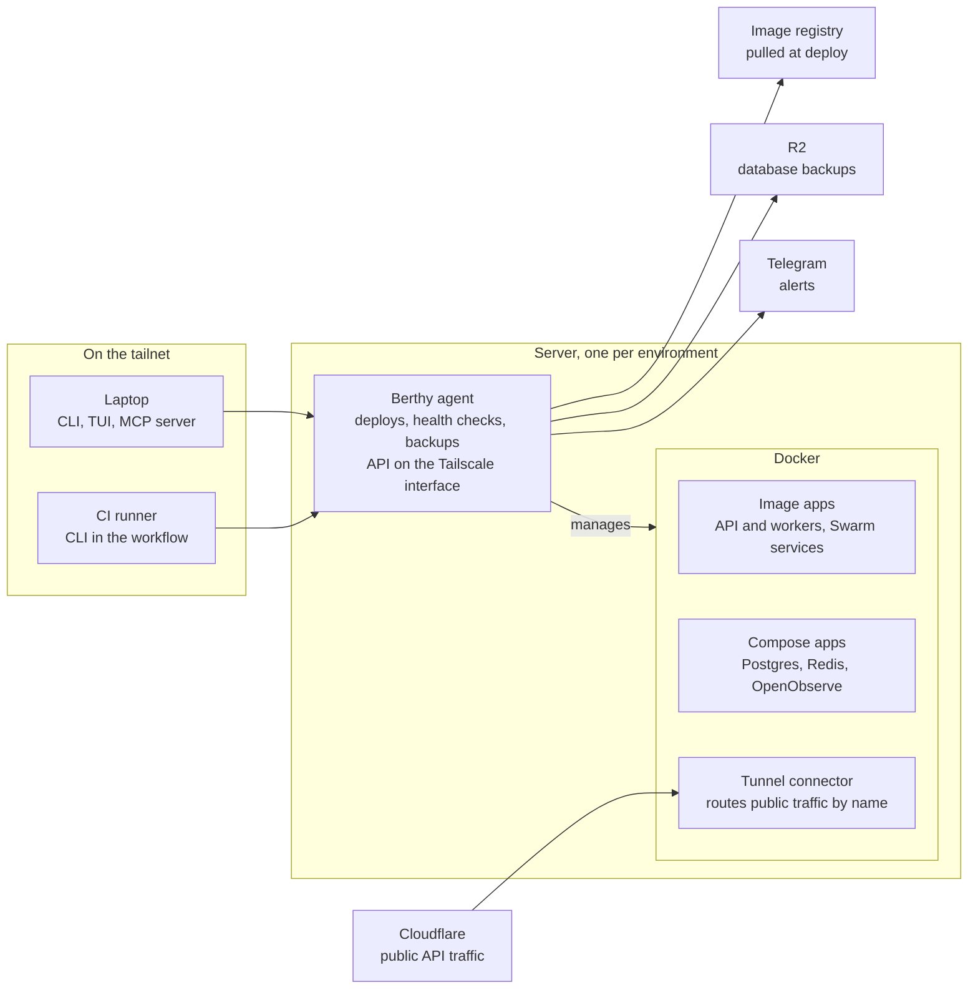

# Berthy v1 spec

Last updated: 2026-11-14

## Summary

Berthy is a small deployment and operations agent that replaces Dokploy on our Dev and Prod servers. It deploys two kinds of application, shows live logs and metrics, runs health checks, and backs up Postgres to R2. People use it through a CLI and a terminal UI; AI agents use the same CLI and an MCP server.

v1 is done when Dev and Prod run without Dokploy, with deploys, monitoring, alerts and backups all handled by Berthy.

"Berthy" is a working name.

## Scope

v1 covers the part of Dokploy we use and nothing else.

**In scope**

- Deploy Docker image apps and Compose apps to one server per environment.
- Image deploys with no downtime: new version starts first, must pass its health check, and rolls back automatically if it does not.
- Live logs per app.
- Live metrics per server and per container: CPU, memory, disk space, Docker disk usage, block I/O and network I/O.
- Health checks with alerts to Telegram.
- Scheduled Postgres backups to R2, with a restore command.
- Every function available from the CLI with JSON output, and through MCP.
- A small footprint: one binary, no database server. The target is under 30 MB of resident memory for the agent, to be measured in phase 1.
- A deployment model that extends to a three-server cluster without redesign.

**Out of scope for v1**

- Reverse proxy, domains and certificates. Cloudflare Tunnel stays the only way in.
- Building images. CI keeps building and pushing them.
- Database provisioning and Postgres high availability.
- Backups of anything other than Postgres.
- Users, teams and roles beyond token scopes.
- Templates and preview environments.
- A web UI.
- Long-term storage of logs and metrics. OpenObserve keeps that job.
- Server provisioning and hardening. Ansible keeps that job.
- Frontend deploys. Cloudflare Pages is unchanged.

## Architecture

Berthy is one static Go binary that runs in four modes, with an agent on each server and no central server between them.



The agent is the only component clients talk to. It drives Docker and reaches the registry, R2 and Telegram itself; public traffic enters only through the tunnel.

| Mode | Runs on | Job |
| --- | --- | --- |
| Agent | Each server, as a systemd service | Talks to Docker; runs deploys, health checks and backups; serves the API |
| CLI | Laptops and the CI runner | Sends commands to an agent; prints text or JSON |
| TUI | Laptops | Live view of apps, logs and metrics |
| MCP server | Wherever an AI agent runs | Exposes the same operations as tools |

### Decisions

- **One agent per server, no gateway.** Each environment's agent is self-sufficient. The CLI keeps named contexts (`dev`, `prod`) and talks to the right agent directly.
- **Swarm mode stays on, even with one node.** Image apps run as Swarm services, which gives rolling updates and rollback for free. Dokploy already set the servers up this way, so existing services can be adopted in place.
- **Tailscale only.** The agent listens on the Tailscale interface and nowhere else. Cloudflare Tunnel keeps routing public traffic to service names on the shared Docker network.
- **A systemd service, not a container.** The agent keeps reporting when Docker itself is unhealthy.
- **HTTP and JSON API.** Streams (logs, metrics, deploy progress) use server-sent events, so `curl` and AI agents can read them without a client library.
- **Go.** Docker's client library, the Compose tooling and the strongest terminal UI libraries are all written in it.

### Where state lives

| State | Lives in |
| --- | --- |
| Desired configuration: apps, checks, backup schedules | Git, as a manifest in the repository |
| What is running | Docker; labels mark what Berthy manages |
| Secrets, deploy history, audit log, backup records | One SQLite file on the server, secrets encrypted |
| Log and metric history | OpenObserve |
| Database backups | R2 |

The agent keeps a copy of the last applied manifest so schedules keep running between deploys. Git remains the source of truth.

## Application model

Berthy manages two kinds of application: image apps for stateless services and Compose apps for everything that holds data or supports the stack.

|  | Image app | Compose app |
| --- | --- | --- |
| Source | An image reference in the container registry | A Compose file from the repository at a given commit |
| Runs as | A Swarm service | A `docker compose` project on one named server |
| Used for | The API and background workers | Postgres, Redis, OpenObserve, the tunnel connector |
| Update | Rolling: new starts first, gated on its health check, automatic rollback | Only changed services are recreated |
| Replicas | One or more | One per service |
| Ports | None published; reached by service name on the shared network | May bind a port to the Tailscale IP |

### Rules

- **Roles.** An image app can define several roles that run the same image with different commands, such as `web` and `worker`. Each role has its own replica count, resources and health check, so API replicas can scale without multiplying job workers. The API starts as a single role; a separate worker role comes later.
- **Stateful apps are separate.** Deploying an image app never touches a Compose app. Restarting or recreating a Compose app marked `stateful` always takes an explicit command that names it.
- **Images are pinned by digest.** The agent resolves the tag to a digest at deploy time and records it. Rollback uses the recorded digest, and a `latest` tag is rejected on Prod.
- **Adoption.** Existing services and Compose projects can be adopted by name without being recreated.
- **One shared network.** All apps join one attachable overlay network, so the tunnel connector resolves them by name. It keeps its current name, `dokploy-network`, through cutover.

## Configuration

All desired configuration lives in the repository as one base manifest plus one overlay per environment.

- `infra/berthy/berthy.yml` holds what is common.
- `infra/berthy/berthy.dev.yml` and `berthy.prod.yml` override it per environment: replicas, resources, schedules.
- Every deploy carries the merged manifest from the commit being deployed. Nothing is configured by hand on the server.

The example below is illustrative; names and values are placeholders.

```yaml
# berthy.yml
project: myapp
network: dokploy-network

apps:
  api:
    kind: image
    image: ghcr.io/<org>/<api-image>
    roles:
      web:
        replicas: 1
        port: 8080
        health:
          test: ["CMD", "curl", "-f", "http://localhost:8080/health"]
          interval: 15s
          timeout: 5s
          start_period: 30s
          retries: 3
    env:
      plain:
        LOG_LEVEL: info
      secret:
        - DATABASE_URL
        - JWT_SIGNING_KEY
    deploy:
      deploy_timeout: 120s
      drain_timeout: 30s
      retain: 5
    hooks:
      pre_deploy:
        - backup: main-db

  postgres:
    kind: compose
    file: infra/berthy/postgres/docker-compose.yml
    stateful: true
```

### Health checks

A role's health check is a command run inside the container, with the same fields Docker uses. The API's current settings carry over unchanged.

| Field | Meaning | API today |
| --- | --- | --- |
| `test` | Command run inside the container; exit code 0 means healthy | `curl -f http://localhost:8080/health` |
| `interval` | Time between checks | 15s |
| `timeout` | Longest one check may take | 5s |
| `start_period` | Grace period after start; failures in it do not count | 30s |
| `retries` | Consecutive failures before the container is unhealthy | 3 |

- Durations are written as `15s`, not in nanoseconds.
- The check runs inside the container, so the image must contain the command. The API image already ships `curl`.
- With these values a container that never becomes healthy is marked unhealthy after about 75 to 90 seconds, inside the 120-second `deploy_timeout`.
- A healthy container is first noticed about 15 seconds after start, so every deploy takes at least that long. An optional `start_interval` checks more often during the start period; confirm the installed Docker version supports it for Swarm services before using it.

### Environment variables

- **Plain** values are written in the manifest and reviewed like code.
- **Secret** values are listed in the manifest by name only. The values live in the agent's encrypted store and are set with `berthy secret set`.
- A deploy stops before changing anything if a named secret has no value.
- Values that differ between environments go in the overlays.

### No default environment

Every command names its environment with `-e dev` or `-e prod`. A command that changes something and names no environment is rejected.

### Checking a manifest

- `berthy config validate -e prod` checks the merged manifest without contacting a server.
- `berthy config show -e prod` prints the merged result with secret values hidden.

## Deploy lifecycle

A deploy either finishes healthy or leaves the previous version running; it never leaves an app half-updated.

### Image app deploy

1. **Lock.** Take the environment's deploy lock. If someone holds it, stop and report who and why.
2. **Check.** Validate the manifest, confirm every named secret has a value, resolve the tag to a digest, pull the image.
3. **Pre-deploy hooks.** Run them in order. A failure stops the deploy with nothing changed.
4. **Start new.** Start the new version beside the old one. It must pass its health check within `deploy_timeout`; failures during the check's `start_period` do not count.
5. **Switch and drain.** Route traffic to the new version. The old one gets a stop signal and `drain_timeout` to finish requests in flight.
6. **Post-deploy hooks.** Run them in order. A failure is reported but does not undo the deploy.
7. **Record and tidy.** Write the deploy record, prune old images, release the lock.

If step 4 fails, the agent rolls back to the previous digest, records the deploy as failed, and sends an alert.

### Deploy lock

- One lock per environment, taken automatically for the length of a deploy.
- `berthy lock acquire -e prod -m "reason"` freezes deploys until someone releases it.
- The lock records its holder, message and age. `berthy lock status` shows them.

### Hooks

Hooks are declared per app as `pre_deploy` and `post_deploy` lists. Two step types exist in v1.

| Step | What it does | Typical use |
| --- | --- | --- |
| `backup: <job>` | Runs a named backup job and waits for it | A database backup before a Prod deploy |
| `run: <command>` | Runs the command once in a container of the new image, with the app's environment | A one-off task before traffic switches |

### Database migrations

Migrations move out of API startup into their own deploy step, and the schema is never rolled back automatically when a deploy fails.

Today the API applies its EF Core migrations when it starts. A failed deploy can leave the schema ahead of the running code, with no defined way back.

**The rule that makes a failed deploy safe.** Every migration must work with the previous version of the API. A rolling deploy already runs the old and new versions against the same database for a short time, so this is required anyway. With it, a failed deploy needs no schema rollback: the old version keeps running on the new schema.

- Add columns and tables in one release; remove or rename them in a later one.
- A change that cannot be made compatible is split across two deploys.

**A generic contract.** Berthy does not know which migration tool an app uses. An app declares three commands, and Berthy runs each in a one-off container with the app's environment.

| Command | Contract | Runs from |
| --- | --- | --- |
| `version` | Prints one line that identifies the current schema state. Berthy stores it and never interprets it. | The new image |
| `apply` | Brings the schema to the latest state the image knows. | The new image |
| `revert` | Brings the schema back to a given state, passed as `{target}`. | The image being rolled back from |

```yaml
    migrations:
      version: [<command>]
      apply: [<command>]
      revert: [<command>, "{target}"]
```

**How a deploy applies migrations.** The block runs after the pre-deploy hooks and before the new version starts.

1. On Prod, the `backup: main-db` hook has already run.
2. Berthy runs `version` and stores the result in the deploy record as the state before.
3. Berthy runs `apply` once.
4. Berthy runs `version` again and stores the state after. One deploy can apply several migrations; the two recorded states mark exactly where it started and ended.
5. If `apply` fails, the deploy stops and the old version keeps running.
6. If it succeeds but the new version fails its health check, the image rolls back and the schema stays where it is.

**Reverting the schema on purpose.** `berthy rollback <app> --revert-schema` runs `revert` with `{target}` set to the state recorded before the failed deploy. Every migration that deploy applied is undone, and nothing else.

- It runs from the newer image, because that image holds the revert code for the migrations it added.
- With `--to <deploy id>`, the target is the state recorded after that deploy.
- It takes an `admin` token and is never automatic, because reverting a migration can delete data.
- An app that declares no `revert` command cannot use it.

**Last resort.** Restore the pre-deploy backup into a scratch database and recover from there. Writes made after that backup are not in it.

**EF Core, as the first user.** The recorded state is the name of the last applied migration. The `dotnet ef` tool needs the .NET SDK and the project source, which a runtime image does not contain, so the contract is met another way:

- A small `migrate` command built into the API, with `status`, `up` and `to <migration>` subcommands. It covers all three commands and needs nothing extra in the image.
- Or an EF Core migration bundle for `apply` and `revert`. A bundle cannot print the current state, so `version` still needs the first option or a query.

On Postgres, a migration that fails is rolled back by its own transaction.

Two changes are needed in the API before this works: stop applying migrations at startup, and add the migration commands to the image.

### Timing settings

| Setting | Meaning | Today | Berthy default |
| --- | --- | --- | --- |
| `deploy_timeout` | Longest the new version may take to become healthy | No overall limit; bounded by the health check | 120s |
| `drain_timeout` | Time the old version gets to finish requests | 10s, Docker's default | 30s |

The wait before health checks count is the health check's own `start_period`, set per role.

### Carried over from the current setup

The API service runs on Dokploy's default Swarm settings, and Berthy keeps the same behaviour with one change.

| Setting | Today | In Berthy |
| --- | --- | --- |
| Update order | Start the new version first | Same |
| Update parallelism | 1 at a time | Same |
| On a failed update | Roll back | Same |
| Rollback order and parallelism | Start first, 1 at a time | Same |
| Restart policy | Not set: Docker restarts on any exit, after 5 seconds, without limit | Same |
| Placement | No constraints | Same |
| Replicas | 1 | Same |
| Resource limits | None | Same at adoption |
| Stop grace period | Not set: Docker's 10 seconds | `drain_timeout`, 30 seconds |

- Thirty seconds matches .NET's default shutdown timeout, so the API gets its full time to finish requests. Today Docker stops it after 10.
- The "Today" column is read from Dokploy's current source code. Confirm it against the running service with `docker service inspect` during adoption.
- At adoption, Berthy compares the running service with the manifest and prints the differences before changing anything.
- With no memory limit, a leak in the API can starve Postgres on the same server. Phase 1 measures the API's real usage so a limit can be chosen.

### Rollback

`berthy rollback <app> -e <env>` redeploys the previous recorded digest with the manifest saved at that deploy. `--to <deploy id>` picks an older one. Secrets stay at their current values.

### Retain and prune

- The agent keeps the images of the last `retain` deploys per app (default 5), so rollback needs no pull.
- After each successful deploy it removes older images, stopped containers and unused layers.
- It never removes volumes.

### Compose app deploy

1. Take the lock and validate, as above.
2. Work out which services would be recreated and print that plan.
3. If a `stateful` service would be recreated, stop unless the command carries `--allow-recreate`.
4. Write the Compose file and environment, then run `docker compose up -d --remove-orphans`.
5. Wait for health checks, record the deploy, release the lock.

### Dry run

Every command that changes something accepts `--dry-run` and prints the plan without acting.

## Interfaces

The CLI is the complete interface; the TUI and the MCP server are two other ways to call the same agent API.

### CLI

Every command takes `-e <env>` and `--json`. Exit codes are meaningful: a failed or rolled-back deploy exits non-zero.

| Command | Purpose | Changes things |
| --- | --- | --- |
| `ps` | Apps, roles, replicas, health, running version | No |
| `describe <app>` | Full detail for one app, including its last deploys | No |
| `logs <app>` | Tail or follow logs; `--since`, `--grep`, `--role` | No |
| `stats` | Server and container metrics; `--watch` for live | No |
| `df` | Disk space and Docker disk usage | No |
| `history <app>` | Deploy records | No |
| `wait <app> --healthy` | Block until an app is healthy or a timeout passes | No |
| `doctor` | Checks the agent, Docker, disk, backups, lock and peer | No |
| `audit` | Who changed what and when | No |
| `config show`, `config validate` | Print or check the merged manifest | No |
| `backup list` | Backups in R2 with size, age and status | No |
| `deploy <app> --version <tag>` | Deploy an image app or a Compose app | Yes |
| `rollback <app>` | Return to a previous deploy | Yes |
| `restart <app>`, `scale <app>` | Restart or change replica count | Yes |
| `exec <app> -- <command>` | Run a command in a running container | Yes |
| `secret set`, `secret list`, `secret rm` | Manage secret values; values are never printed | Yes |
| `lock acquire`, `lock release`, `lock status` | Manage the deploy lock | Yes |
| `backup run <job>`, `restore <backup>` | Run a backup now; restore one | Yes |
| `prune` | Remove old images and stopped containers now | Yes |
| `approve <id>` | Approve a pending change requested by an AI agent | Yes |

### TUI

`berthy ui -e <env>` opens a live view built for reading first.

- Apps with health, replicas and running version.
- Detail for the selected app: roles, last deploys, restarts.
- Live logs for the selected app.
- Server meters: CPU, memory, disk, Docker disk usage, block and network I/O.
- Status line: deploy lock, last backup age, pending approvals.

Actions in the TUI (restart, rollback, approve) ask for confirmation and show the same plan as `--dry-run`.

### MCP server

`berthy mcp` runs a local MCP server that calls the agent API with the token it was given. Tool names follow the Aspire MCP tools we already use locally, so an AI agent asks Dev and Prod the same questions it asks a local run.

| Tool | Maps to |
| --- | --- |
| `list_resources` | `ps` |
| `describe_resource` | `describe` |
| `list_console_logs` | `logs` |
| `get_stats` | `stats` and `df` |
| `list_deploys` | `history` |
| `list_backups` | `backup list` |
| `wait_for_resources` | `wait` |
| `doctor` | `doctor` |
| `execute_resource_command` | `deploy`, `rollback`, `restart`, `backup run` |

On Prod, `execute_resource_command` creates a pending approval instead of acting. See Security and guardrails.

## Monitoring, logs and health checks

The agent shows what is happening now and raises alerts; OpenObserve keeps the history.

### Metrics

| Scope | Metrics | Read from |
| --- | --- | --- |
| Server | CPU, memory, swap, load, disk space per mount, disk I/O, network I/O | The kernel's `/proc` and filesystem stats |
| Docker | Disk used by images, containers, volumes and build cache | The Docker API |
| Container | CPU, memory against its limit, block I/O, network I/O, restarts, out-of-memory kills | Control groups and the Docker API |

- Sampled every 10 seconds (proposed).
- The last hour is held in memory for `stats` and the TUI. Nothing is written to disk.
- Samples are exported to OpenObserve over OpenTelemetry for dashboards and long-term history.

### Logs

- `logs` tails or follows container output straight from Docker, per app, role or replica.
- The agent stores no logs. History and search stay in OpenObserve.
- Docker's log rotation stays as Ansible configures it.

### Health checks

| Kind | What it checks | Effect |
| --- | --- | --- |
| Container health check | The check declared for a role in the manifest | Gates deploys; an unhealthy container is replaced |
| Probe | An HTTP or TCP check the agent runs on a schedule, against a service name or a public URL | Alert |
| Built-in condition | Disk space, Docker disk usage, memory, restart loops, overdue backup, silent peer | Alert |

Proposed thresholds: disk space and Docker disk usage warn at 80% and go critical at 90%.

### Alerts

- Alerts go to Telegram only in v1. Other channels can be added later.
- An alert is sent when a check changes state, failing or recovering, with a reminder while it stays failing.

### Peer check

The Dev and Prod agents probe each other over Tailscale, and each alerts when the other goes silent. This covers a server that is completely down, which cannot report itself.

It does not cover both servers failing together or a Tailscale outage. Keep one external check on the public API URL for that. The current server monitoring and uptime tools keep running beside Berthy for now.

## Backups and restore

Berthy takes over the scheduled Postgres backups to R2 that Dokploy runs today. v1 backs up Postgres only.

### What runs today

Two Dokploy schedules produce today's backups.

| Step | When (UTC) | What it does |
| --- | --- | --- |
| Dump | 00:00 (`0 0 * * *`) | Runs the command below, writing one file into the `backups` volume |
| Volume backup | 01:00 (`0 1 * * *`) | Packs the whole `backups` volume into a `.tar` file and uploads it to R2 |

```sh
set -o pipefail; pg_dump -Fc --no-acl --no-owner -U postgres --no-password '<database>' | gzip > /backups/backup.sql.gz
```

- R2 keeps every archive. "Keep latest backups" is empty.
- Each archive in R2 is an uncompressed `.tar` holding that one gzip-wrapped dump file.
- The local file is overwritten every night and emptied before the dump starts, so a dump that fails part-way destroys the previous local copy.
- The upload does not check the dump. If the dump failed, or is still running at 01:00, a broken file is uploaded without an error.

Berthy replaces both steps with one. The dump runs at the same time with the same database and `pg_dump` options, and streams straight to R2.

### Configuration

Backup jobs are declared in the manifest. The schedule, database, options and keep-all retention match today's job. Schedules are in UTC.

```yaml
backups:
  main-db:
    app: postgres          # the Compose app
    service: postgres      # the service inside it
    database: <database>
    user: postgres
    options: ["--no-acl", "--no-owner"]
    schedule: "0 0 * * *"  # 00:00 UTC, as today
    destination: r2
    prefix: postgres/<database>
    retention:
      keep: all            # nothing is deleted, as today
```

### How a backup runs

1. The agent runs `pg_dump` in custom format inside the database container.
2. The output streams straight into a multipart upload to R2. No temporary file touches the server's disk.
3. If `pg_dump` exits with an error or the stream breaks, the upload is aborted. A partial dump never appears as a backup.
4. On success the agent records the object key, size, duration, checksum and Postgres version.
5. Retention is applied. With keep-all, nothing is removed.

### Safety checks

- **Overdue backup.** If the newest good backup is older than the schedule allows, the agent alerts. The age also shows in `ps`, `doctor` and the TUI.
- **Size anomaly.** A backup under half the size of the previous one raises an alert (proposed threshold).
- **Failure.** Any failed run alerts with the error from `pg_dump` or the upload.

### Restore

- `berthy backup list -e prod` shows what is in R2.
- `berthy restore <backup> --into <scratch-database>` restores into a new scratch database. This is the default and is safe to run at any time.
- Restoring over a live database takes `--replace <database>` and, on Prod, an admin token.
- Backups made before Berthy stay restorable. Each is a `.tar` archive holding a gzip-wrapped custom-format dump, and `restore` unpacks it.

### Credentials

- The R2 token is scoped to the backup bucket only and lives in the agent's secret store.
- Consider a retention lock on the bucket, so a compromised server cannot delete backup history.

### Agent state

The agent's SQLite file is uploaded to R2 daily. The key that encrypts its secrets is not in that upload; it is kept in the Ansible vault. A server is rebuilt from Ansible, the agent state, and a database restore.

### Limits

- These are logical dumps. A failure can lose up to one schedule interval of data.
- Keep-all means storage in R2 grows without bound. A lifecycle rule on the bucket can cap it later.
- Point-in-time recovery through write-ahead log archiving is not in v1.
- A scheduled restore drill into a throwaway container is planned after v1.

## Security and guardrails

The agent controls Docker, which is equivalent to root on the server, so its API is reachable only over Tailscale and every call carries a scoped token.

### Tokens

Each token belongs to one environment and one scope.

| Scope | Allows |
| --- | --- |
| `read` | `ps`, `describe`, `logs`, `stats`, `df`, `history`, `doctor`, `audit`, `backup list` |
| `deploy` | Everything in `read`, plus `deploy`, `rollback`, `restart`, `scale`, `backup run`, `lock acquire` and `lock release` |
| `admin` | Everything in `deploy`, plus secrets, `exec`, `restore`, `approve`, recreating stateful apps, and token management |

- CI holds a `deploy` token for Dev. The Prod `deploy` token is used only by the manually triggered workflow.
- AI agents get `read` tokens by default.

### Approval for AI agents on Prod

1. An AI agent's token is marked as an agent token when it is created.
2. A change requested on Prod with an agent token is not carried out. The agent stores it as a pending approval with its dry-run plan.
3. A person reviews the plan and runs `berthy approve <id>`, or approves in the TUI.
4. An unapproved request expires after 15 minutes (proposed).

### Other guardrails

- **Explicit environment.** No command that changes something runs without `-e`.
- **Dry run everywhere.** The plan a person approves is the same plan `--dry-run` prints.
- **Deploy lock.** A manual lock freezes an environment for everyone, people and AI agents alike.
- **Stateful protection.** Recreating or removing a `stateful` Compose app needs `--allow-recreate` and an `admin` token.
- **Audit log.** Every change is recorded with time, token name, the caller's Tailscale identity, command, target and outcome.

### Secrets

- Encrypted at rest with a key file readable only by the agent's system user.
- Write-only through the API: values can be set and removed, and names can be listed, but values are never returned.
- Hidden in `config show`, deploy records and agent logs.

## GitHub and CI integration

In v1, CI pushes deploys to the agent; the agent does not read the repository.

### What changes in the workflow

- The step that calls Dokploy becomes one command: `berthy deploy api -e dev --version <tag>`.
- The CLI reads the manifest and Compose files from the checked-out commit and sends them with the commit SHA.
- The command waits for the result and exits non-zero if the deploy fails or rolls back. Today's step does not check the deploy's outcome, so the workflow can pass and move the Dev tag after a failed deploy.

### What stays the same

- CI builds and pushes the image, with the same tags.
- The Prod provenance checks and the image digest comparison.
- The git tags that mark what is live in each environment. They stay in the workflow and now move only after a deploy that succeeded.
- The Prod deploy remains a manual trigger.
- Frontend deploys to Cloudflare Pages.

### Credentials

- The agent holds one read-only credential for pulling images from the container registry.
- The agent holds no repository credentials in v1.
- CI holds a Berthy `deploy` token per environment as a GitHub secret.
- CI holds a Tailscale OAuth client per environment as a GitHub secret.

### Reaching the agent

The self-hosted CI runners are not on the tailnet, so the deploy job joins it for the length of the job.

- The workflow uses the official [Tailscale GitHub Action](https://github.com/tailscale/github-action) with an OAuth client. It registers the runner as an ephemeral, tagged node that is removed when the job ends.
- Access rules let the CI tag reach the agent's API port and nothing else on the tailnet.
- Dev and Prod use separate tags and separate OAuth clients. The Prod client's secret lives in the GitHub `Prod` environment, so only the manually triggered Prod job can use it.
- The Berthy token is still required. Reaching the agent grants nothing by itself.
- On a long-lived self-hosted runner, the action leaves the Tailscale binaries installed and stops its background processes after the job.

### After v1

A GitHub App that lets the agent read the repository and deploy on push without a workflow step. It is not needed while CI does the pushing.

## Optional multi-node mode

A three-server cluster is not a v1 deliverable, but nothing in v1 may block it. Because image apps are already Swarm services, going from one server to three changes configuration, not the deployment model.

### What it takes

- Join two more servers as managers. Three managers keep the cluster working with one server down.
- Run an agent on each server. Any manager accepts deploys; `ps` and `stats` query all agents and merge the answers.
- Raise the replica count of image apps and spread them across servers, with a cap per server.
- Run the tunnel connector on every server with the same tunnel token.
- Keep Compose apps pinned to a named server with `node: <name>` in the manifest. That server's agent runs their backups.

### Known constraints

- **Cluster traffic over Tailscale.** The overlay network's packet size must be lowered to fit inside Tailscale's 1280 bytes, or packets are dropped silently. Test this before relying on it.
- **The database stays a single point of failure.** More API replicas survive a lost server and give rolling deploys. They do not make Postgres highly available, which is a separate project.
- **One provider, one failure domain.** Three servers at the same provider can fail together.
- **Background jobs.** Check for in-process timers before running more than one replica, or use roles to keep a single worker.

### OpenObserve placement

OpenObserve runs as one instance per environment and stays one instance even if an environment grows to three servers. It is made durable, not highly available.

- **Not one per server.** Single-node instances do not replicate to each other, so three of them would be three separate datasets.
- **Not its clustered mode.** That mode needs object storage, PostgreSQL and a coordination service, and is documented for Kubernetes only ([architecture docs](https://openobserve.ai/docs/architecture/)).
- **Data in R2.** OpenObserve keeps its data in R2, so logs and traces survive the loss of a server.
- **Pinned to one server** as a Compose app. If that server fails, it is redeployed on another and reads the same data. It may move to its own server later.
- **Metadata needs a backup.** Dashboards, alerts, users and the access-control data live in local files. Berthy v1 backs up Postgres only, so this needs its own arrangement.
- **Prod alerts must not depend on it.** A "Prod is down" alert comes from the peer check and the external check, not from OpenObserve.

A short OpenObserve outage is accepted: it loses telemetry for its duration and nothing else, and the API keeps serving.

## Rollout plan

Berthy is built and proven on Dev beside Dokploy, one capability at a time, and Dokploy is removed only after Prod has run a deploy, a backup and a restore through Berthy.

| Phase | Delivers | Done when |
| --- | --- | --- |
| 1. Read-only | Agent and CLI on Dev: `ps`, `describe`, `logs`, `stats`, `df`, `doctor`, JSON output, tokens | Numbers agree with `docker stats` and the current monitoring; agent memory is measured |
| 2. Image deploys | `deploy`, `rollback`, lock, hooks, timing settings, retain and prune, history, audit; the Dev API service adopted; the CI step swapped | Dev has deployed through Berthy for two weeks, including one forced failure that rolled back |
| 3. Compose, checks, backups | Compose apps, secrets, probes, built-in conditions, alerts, peer check, backups and restore | A Berthy backup has been restored into a scratch database; a test failure raised an alert |
| 4. TUI and MCP | `berthy ui`, `berthy mcp`, agent tokens and approvals | An AI agent's Prod request was held, reviewed and approved end to end |
| 5. Prod cutover | Prod services adopted, backups moved, Dokploy removed from Prod and then Dev, Ansible roles updated | Prod has done one deploy, one backup and one restore test; no Dokploy containers remain |
| 6. Multi-node (optional) | Cluster helpers, placement settings, merged views | Not scheduled |

### Rules during the transition

- **One writer per app.** Once Berthy adopts an app, Dokploy's automatic deploy for that app is switched off.
- **Backups overlap.** Dokploy's backups keep running until a Berthy backup has been restored successfully.
- **Dokploy stays installed but idle** until phase 5 is done, as the way back.

### Cutover checklist

- [ ] Copy every environment variable from Dokploy into the manifest or the secret store.
- [ ] Switch off both Dokploy backup schedules once a Berthy backup has been restored.
- [ ] Create an R2 token scoped to the backup bucket.
- [ ] Store the agent's encryption key in the Ansible vault.
- [ ] Set up CI access to the tailnet: OAuth clients, tags and access rules for Dev and Prod.
- [ ] Move migrations out of API startup and add the migration commands to the image.
- [ ] Replace the Dokploy role in Ansible with a Berthy role, and update the verify role.
- [ ] Restore one Berthy backup on Prod into a scratch database before removing Dokploy.

## Open questions

These need an answer before or during phase 1.

- [ ] Should a failed deploy ever revert the schema automatically, or is revert always a manual command? The spec assumes manual.
- [ ] EF Core: a `migrate` command built into the API, or a migration bundle plus a separate way to read the current state?
- [ ] Should the API get a memory limit once phase 1 has measured its usage?

### Resolved

| Question | Decision |
| --- | --- |
| Is the CI runner on the tailnet? | No. The deploy job joins as an ephemeral, tagged node with restricted access. |
| Backup schedule | Nightly at 00:00 UTC, same database and `pg_dump` options as today. |
| How backups reach R2 today | A volume backup at 01:00 UTC uploads the dump file inside a `.tar`. |
| Backup retention | Keep all. |
| Migration rollback | Generic `version`, `apply` and `revert` commands, with the schema state recorded on every deploy. |
| API replicas and limits | 1 replica, no resource limits. |
| API environment variables | Kept out of this spec. They are collected in the application's own repository at cutover. |
| Separate `web` and `worker` roles? | Not today. The API starts as one role; the split comes later. |
| Migrations at startup? | Yes today. They move to their own deploy step; see Database migrations. |
| Shared network name | Stays `dokploy-network` through cutover. |
| Metrics format | OpenTelemetry. |
| Replace the current monitoring and uptime tools? | No. Berthy runs beside them for now. |
| Secret values | Kept in the agent's store for now. |
| Own repository? | Yes. |
| Implementation language | Go. |
| OpenObserve in a cluster | One instance per environment with its data in R2; it may move to its own server later. |
| OpenObserve with R2 | R2 is S3-compatible and treated as supported. |
