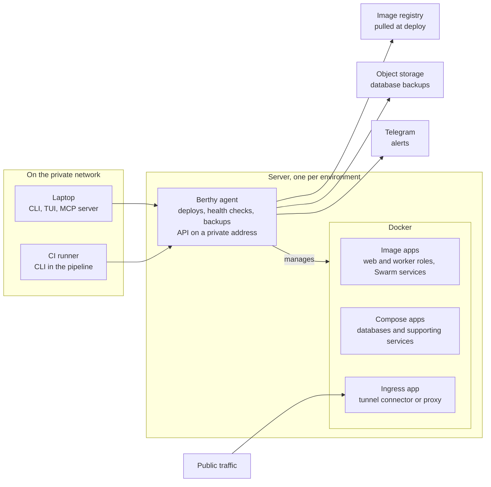

# Berthy v1 spec

Last updated: 2026-11-14

## Summary

Berthy is a small deployment and operations agent for Docker servers. It deploys two kinds of application, shows live logs and metrics, runs health checks with alerts, and backs up Postgres to object storage. People use it through a CLI and a terminal UI; AI agents use the same CLI and an MCP server.

It is built for a small team that runs a web application on its own servers: one server per environment, with an optional three-server cluster.

v1 is done when an environment can be run entirely through Berthy, with deploys, monitoring, alerts and backups all handled by it.

"Berthy" is a working name.

## Scope

v1 is deliberately small. It covers what it takes to run a web application and its supporting services on one server per environment, and nothing else.

**In scope**

- Deploy Docker image apps and Compose apps to one server per environment.
- Image deploys with no downtime: new version starts first, must pass its health check, and rolls back automatically if it does not.
- Live logs per app.
- Live metrics per server and per container: CPU, memory, disk space, Docker disk usage, block I/O and network I/O.
- Health checks with alerts to Telegram.
- Scheduled Postgres backups to S3-compatible object storage, with a restore command.
- Every function available from the CLI with JSON output, and through MCP.
- A small footprint: one binary, no database server. The target is under 30 MB of resident memory for the agent, to be measured in phase 1.
- A deployment model that extends to a three-server cluster without redesign.
- Adopting apps that another deployment tool already runs, without recreating them.

**Out of scope for v1**

- Reverse proxy, domains and certificates. Berthy ships no proxy; public traffic enters through a tunnel connector or proxy that runs as an ordinary app.
- Building images. CI builds and pushes them.
- Database provisioning and Postgres high availability.
- Backups of anything other than Postgres.
- Users, teams and roles beyond token scopes.
- Templates and preview environments.
- A web UI.
- Long-term storage of logs and metrics. Berthy exports them over OpenTelemetry to a backend of your choice.
- Server provisioning and hardening.

## Architecture

Berthy is one static Go binary that runs in four modes, with an agent on each server and no central server between them.



The agent is the only component clients talk to. It drives Docker and reaches the registry, object storage and Telegram itself; public traffic enters only through the ingress app.

| Mode | Runs on | Job |
| --- | --- | --- |
| Agent | Each server, as a systemd service | Talks to Docker; runs deploys, health checks and backups; serves the API |
| CLI | Laptops and the CI runner | Sends commands to an agent; prints text or JSON |
| TUI | Laptops | Live view of apps, logs and metrics |
| MCP server | Wherever an AI agent runs | Exposes the same operations as tools |

### Decisions

- **One agent per server, no gateway.** Each environment's agent is self-sufficient. The CLI keeps one named context per environment and talks to the right agent directly.
- **Swarm mode is always on, even with one node.** Image apps run as Swarm services, which gives rolling updates and rollback for free, and the same model extends to a cluster.
- **Private network only.** The agent listens on one configured address, which should belong to a private network such as a WireGuard-based VPN. It never listens on all interfaces.
- **No bundled proxy.** Ingress is an ordinary app on the shared Docker network that routes to other apps by service name.
- **A systemd service, not a container.** The agent keeps reporting when Docker itself is unhealthy.
- **HTTP and JSON API.** Streams (logs, metrics, deploy progress) use server-sent events, so `curl` and AI agents can read them without a client library.
- **Go.** Docker's client library, the Compose tooling and the strongest terminal UI libraries are all written in it.

### Where state lives

| State | Lives in |
| --- | --- |
| Desired configuration: apps, checks, backup schedules | Git, as a manifest in the application's repository |
| What is running | Docker; labels mark what Berthy manages |
| Secrets, deploy history, audit log, backup records | One SQLite file on the server, secrets encrypted |
| Log and metric history | An OpenTelemetry backend, if one is configured |
| Database backups | Object storage |

The agent keeps a copy of the last applied manifest so schedules keep running between deploys. Git remains the source of truth.

## Application model

Berthy manages two kinds of application: image apps for stateless services and Compose apps for everything that holds data or supports the stack.

|  | Image app | Compose app |
| --- | --- | --- |
| Source | An image reference in a container registry | A Compose file from the repository at a given commit |
| Runs as | A Swarm service | A `docker compose` project on one named server |
| Used for | Web services and background workers | Databases, caches, telemetry backends, the ingress app |
| Update | Rolling: new starts first, gated on its health check, automatic rollback | Only changed services are recreated |
| Replicas | One or more | One per service |
| Ports | None published; reached by service name on the shared network | May bind a port to a private address |

### Rules

- **Roles.** An image app can define several roles that run the same image with different commands, such as `web` and `worker`. Each role has its own replica count, resources and health check, so web replicas can scale without multiplying job workers. An app can start with one role and split later.
- **Stateful apps are separate.** Deploying an image app never touches a Compose app. Restarting or recreating a Compose app marked `stateful` always takes an explicit command that names it.
- **Images are pinned by digest.** The agent resolves the tag to a digest at deploy time and records it. Rollback uses the recorded digest. Protected environments reject mutable tags such as `latest`.
- **Adoption.** Existing services and Compose projects can be adopted by name without being recreated. See Adopting an existing deployment.
- **One shared network.** All apps join one attachable overlay network, so the ingress app resolves them by name. Its name is set in the manifest, so an existing network can be kept.

## Configuration

All desired configuration lives in the application's repository as one base manifest plus one overlay per environment.

- `berthy.yml` holds what is common.
- `berthy.<environment>.yml` overrides it per environment: replicas, resources, schedules.
- Every deploy carries the merged manifest from the commit being deployed. Nothing is configured by hand on the server.

The examples in this spec use two environments named `dev` and `prod`. Names and values are placeholders.

```yaml
# berthy.yml
project: myapp
network: myapp

apps:
  api:
    kind: image
    image: ghcr.io/<org>/<image>
    roles:
      web:
        replicas: 1
        port: 8080
        health:
          test: ["CMD", "curl", "-f", "http://localhost:8080/health"]
          interval: 15s
          timeout: 5s
          start_period: 30s
          retries: 3
    env:
      plain:
        LOG_LEVEL: info
      secret:
        - DATABASE_URL
        - JWT_SIGNING_KEY
    deploy:
      deploy_timeout: 120s
      drain_timeout: 30s
      retain: 5
    hooks:
      pre_deploy:
        - backup: main-db

  postgres:
    kind: compose
    file: deploy/postgres/docker-compose.yml
    stateful: true
```

### Environments

An environment is one named target: its own server or cluster, agent, overlay, secrets and tokens.

- **No default environment.** Every command names its environment with `-e <name>`. A command that changes something and names no environment is rejected.
- **Protected environments.** An overlay can set `protected: true`, typically for production. A protected environment rejects mutable image tags, and holds changes requested by AI agents until a person approves them.

```yaml
# berthy.prod.yml
protected: true
```

### Health checks

A role's health check is a command run inside the container, with the same fields Docker uses.

| Field | Meaning | Example |
| --- | --- | --- |
| `test` | Command run inside the container; exit code 0 means healthy | `curl -f http://localhost:8080/health` |
| `interval` | Time between checks | 15s |
| `timeout` | Longest one check may take | 5s |
| `start_period` | Grace period after start; failures in it do not count | 30s |
| `retries` | Consecutive failures before the container is unhealthy | 3 |

- Durations are written as `15s`, not in nanoseconds.
- The check runs inside the container, so the image must contain the command.
- With the example values a container that never becomes healthy is marked unhealthy after about 75 to 90 seconds, inside the 120-second `deploy_timeout`.
- A healthy container is first noticed about one `interval` after start, so every deploy takes at least that long. An optional `start_interval` checks more often during the start period; confirm the installed Docker version supports it for Swarm services before using it.

### Environment variables

- **Plain** values are written in the manifest and reviewed like code.
- **Secret** values are listed in the manifest by name only. The values live in the agent's encrypted store and are set with `berthy secret set`.
- A deploy stops before changing anything if a named secret has no value.
- Values that differ between environments go in the overlays.

### Checking a manifest

- `berthy config validate -e prod` checks the merged manifest without contacting a server.
- `berthy config show -e prod` prints the merged result with secret values hidden.

## Deploy lifecycle

A deploy either finishes healthy or leaves the previous version running; it never leaves an app half-updated.

### Image app deploy

1. **Lock.** Take the environment's deploy lock. If someone holds it, stop and report who and why.
2. **Check.** Validate the manifest, confirm every named secret has a value, resolve the tag to a digest, pull the image.
3. **Pre-deploy hooks.** Run them in order. A failure stops the deploy with nothing changed.
4. **Start new.** Start the new version beside the old one. It must pass its health check within `deploy_timeout`; failures during the check's `start_period` do not count.
5. **Switch and drain.** Route traffic to the new version. The old one gets a stop signal and `drain_timeout` to finish requests in flight.
6. **Post-deploy hooks.** Run them in order. A failure is reported but does not undo the deploy.
7. **Record and tidy.** Write the deploy record, prune old images, release the lock.

If step 4 fails, the agent rolls back to the previous digest, records the deploy as failed, and sends an alert.

### Deploy lock

- One lock per environment, taken automatically for the length of a deploy.
- `berthy lock acquire -e prod -m "reason"` freezes deploys until someone releases it.
- The lock records its holder, message and age. `berthy lock status` shows them.

### Hooks

Hooks are declared per app as `pre_deploy` and `post_deploy` lists. Two step types exist in v1.

| Step | What it does | Typical use |
| --- | --- | --- |
| `backup: <job>` | Runs a named backup job and waits for it | A database backup before a production deploy |
| `run: <command>` | Runs the command once in a container of the new image, with the app's environment | A one-off task before traffic switches |

### Database migrations

Migrations run as their own deploy step, not at application startup, and the schema is never rolled back automatically when a deploy fails.

An app that applies migrations when it starts can leave the schema ahead of the running code after a failed deploy, with no defined way back.

**The rule that makes a failed deploy safe.** Every migration must work with the previous version of the app. A rolling deploy already runs the old and new versions against the same database for a short time, so this is required anyway. With it, a failed deploy needs no schema rollback: the old version keeps running on the new schema.

- Add columns and tables in one release; remove or rename them in a later one.
- A change that cannot be made compatible is split across two deploys.

**A generic contract.** Berthy does not know which migration tool an app uses. An app declares three commands, and Berthy runs each in a one-off container with the app's environment.

| Command | Contract | Runs from |
| --- | --- | --- |
| `version` | Prints one line that identifies the current schema state, such as the name of the last applied migration. Berthy stores it and never interprets it. | The new image |
| `apply` | Brings the schema to the latest state the image knows. | The new image |
| `revert` | Brings the schema back to a given state, passed as `{target}`. | The image being rolled back from |

```yaml
    migrations:
      version: [<command>]
      apply: [<command>]
      revert: [<command>, "{target}"]
```

**How a deploy applies migrations.** The block runs after the pre-deploy hooks and before the new version starts.

1. The pre-deploy hooks have already run, including a `backup:` step if one is declared.
2. Berthy runs `version` and stores the result in the deploy record as the state before.
3. Berthy runs `apply` once.
4. Berthy runs `version` again and stores the state after. One deploy can apply several migrations; the two recorded states mark exactly where it started and ended.
5. If `apply` fails, the deploy stops and the old version keeps running. The state after is still recorded, because a failed `apply` may have applied some of its migrations.
6. If it succeeds but the new version fails its health check, the image rolls back and the schema stays where it is.

**Reverting the schema on purpose.** `berthy rollback <app> --revert-schema` runs `revert` with `{target}` set to the state recorded before the failed deploy. Every migration that deploy applied is undone, and nothing else.

- It runs from the newer image, because that image holds the revert code for the migrations it added.
- With `--to <deploy id>`, the target is the state recorded after that deploy.
- It takes an `admin` token and is never automatic, because reverting a migration can delete data.
- An app that declares no `revert` command cannot use it.

**Last resort.** Restore the pre-deploy backup into a scratch database and recover from there. Writes made after that backup are not in it.

**What the app must provide.** The three commands must be runnable from the app's image. An app that migrates at startup stops doing so once Berthy runs the migration step.

### Timing settings

| Setting | Meaning | Docker's default | Berthy default |
| --- | --- | --- | --- |
| `deploy_timeout` | Longest the new version may take to become healthy | No overall limit; bounded by the health check | 120s |
| `drain_timeout` | Time the old version gets to finish requests | 10s | 30s |

The wait before health checks count is the health check's own `start_period`, set per role.

### Service defaults

An image app that sets nothing else runs with these Swarm settings.

| Setting | Berthy default |
| --- | --- |
| Update order | Start the new version first |
| Update parallelism | 1 at a time |
| On a failed update | Roll back |
| Rollback order and parallelism | Start first, 1 at a time |
| Restart policy | Docker's default: restart on any exit, after 5 seconds, without limit |
| Placement | No constraints |
| Replicas | 1 |
| Resource limits | None unless set per role |
| Stop grace period | `drain_timeout`, 30 seconds |

- Thirty seconds gives a web framework's graceful shutdown its full time to finish requests. Docker alone would stop the container after 10.
- With no memory limit, a leak in one app can starve a database on the same server. Set a limit per role once real usage is known.

### Rollback

`berthy rollback <app> -e <env>` redeploys the previous recorded digest with the manifest saved at that deploy. `--to <deploy id>` picks an older one. Secrets stay at their current values.

### Retain and prune

- The agent keeps the images of the last `retain` deploys per app (default 5), so rollback needs no pull.
- After each successful deploy it removes older images, stopped containers and unused layers.
- It never removes volumes.

### Compose app deploy

1. Take the lock and validate, as above.
2. Work out which services would be recreated and print that plan.
3. If a `stateful` service would be recreated, stop unless the command carries `--allow-recreate`.
4. Write the Compose file and environment, then run `docker compose up -d --remove-orphans`.
5. Wait for health checks, record the deploy, release the lock.

### Dry run

Every command that changes something accepts `--dry-run` and prints the plan without acting.

## Interfaces

The CLI is the complete interface; the TUI and the MCP server are two other ways to call the same agent API.

### CLI

Every command takes `-e <env>` and `--json`. Exit codes are meaningful: a failed or rolled-back deploy exits non-zero.

| Command | Purpose | Changes things |
| --- | --- | --- |
| `ps` | Apps, roles, replicas, health, running version | No |
| `describe <app>` | Full detail for one app, including its last deploys | No |
| `logs <app>` | Tail or follow logs; `--since`, `--grep`, `--role` | No |
| `stats` | Server and container metrics; `--watch` for live | No |
| `df` | Disk space and Docker disk usage | No |
| `history <app>` | Deploy records | No |
| `wait <app> --healthy` | Block until an app is healthy or a timeout passes | No |
| `doctor` | Checks the agent, Docker, disk, backups, lock and peers | No |
| `audit` | Who changed what and when | No |
| `config show`, `config validate` | Print or check the merged manifest | No |
| `backup list` | Backups in object storage with size, age and status | No |
| `deploy <app> --version <tag>` | Deploy an image app or a Compose app | Yes |
| `rollback <app>` | Return to a previous deploy | Yes |
| `restart <app>`, `scale <app>` | Restart or change replica count | Yes |
| `exec <app> -- <command>` | Run a command in a running container | Yes |
| `secret set`, `secret list`, `secret rm` | Manage secret values; values are never printed | Yes |
| `lock acquire`, `lock release`, `lock status` | Manage the deploy lock | Yes |
| `backup run <job>`, `restore <backup>` | Run a backup now; restore one | Yes |
| `prune` | Remove old images and stopped containers now | Yes |
| `approve <id>` | Approve a pending change requested by an AI agent | Yes |

### TUI

`berthy ui -e <env>` opens a live view built for reading first.

- Apps with health, replicas and running version.
- Detail for the selected app: roles, last deploys, restarts.
- Live logs for the selected app.
- Server meters: CPU, memory, disk, Docker disk usage, block and network I/O.
- Status line: deploy lock, last backup age, pending approvals.

Actions in the TUI (restart, rollback, approve) ask for confirmation and show the same plan as `--dry-run`.

### MCP server

`berthy mcp` runs a local MCP server that calls the agent API with the token it was given. Tool names follow those of the Aspire MCP server, so an AI agent can ask a deployed environment the same questions it asks a local run.

| Tool | Maps to |
| --- | --- |
| `list_resources` | `ps` |
| `describe_resource` | `describe` |
| `list_console_logs` | `logs` |
| `get_stats` | `stats` and `df` |
| `list_deploys` | `history` |
| `list_backups` | `backup list` |
| `wait_for_resources` | `wait` |
| `doctor` | `doctor` |
| `execute_resource_command` | `deploy`, `rollback`, `restart`, `backup run` |

On a protected environment, `execute_resource_command` creates a pending approval instead of acting. See Security and guardrails.

## Monitoring, logs and health checks

The agent shows what is happening now and raises alerts. History is kept by an OpenTelemetry backend, if one is configured.

### Metrics

| Scope | Metrics | Read from |
| --- | --- | --- |
| Server | CPU, memory, swap, load, disk space per mount, disk I/O, network I/O | The kernel's `/proc` and filesystem stats |
| Docker | Disk used by images, containers, volumes and build cache | The Docker API |
| Container | CPU, memory against its limit, block I/O, network I/O, restarts, out-of-memory kills | Control groups and the Docker API |

- Sampled every 10 seconds (proposed).
- The last hour is held in memory for `stats` and the TUI. Nothing is written to disk.
- Samples are exported over OpenTelemetry when the manifest names an endpoint. Without one, Berthy still shows live metrics and the last hour.

```yaml
telemetry:
  otlp_endpoint: http://<collector>:4318
```

### Logs

- `logs` tails or follows container output straight from Docker, per app, role or replica.
- The agent stores no logs. History and search belong to a log backend the apps send to.
- Log rotation is left to the server's Docker configuration.

### Health checks

| Kind | What it checks | Effect |
| --- | --- | --- |
| Container health check | The check declared for a role in the manifest | Gates deploys; an unhealthy container is replaced |
| Probe | An HTTP or TCP check the agent runs on a schedule, against a service name or a public URL | Alert |
| Built-in condition | Disk space, Docker disk usage, memory, restart loops, overdue backup, silent peer | Alert |

Proposed thresholds: disk space and Docker disk usage warn at 80% and go critical at 90%.

### Alerts

- Alerts go to Telegram only in v1. Other channels can be added later.
- An alert is sent when a check changes state, failing or recovering, with a reminder while it stays failing.

### Peer check

Agents in different environments can be named as peers. Each probes the others over the private network and alerts when one goes silent. This covers a server that is completely down, which cannot report itself.

It does not cover all servers failing together or an outage of the private network. Keep one external check on the application's public URL for that.

## Backups and restore

Berthy runs scheduled Postgres backups to S3-compatible object storage. v1 backs up Postgres only.

### Configuration

Backup jobs and their destinations are declared in the manifest. Schedules are in UTC.

```yaml
destinations:
  offsite:
    type: s3
    endpoint: https://<s3-endpoint>
    bucket: <bucket>
    # the access key and secret are set with `berthy secret set`

backups:
  main-db:
    app: postgres          # the Compose app
    service: postgres      # the service inside it
    database: <database>
    user: postgres
    options: ["--no-acl", "--no-owner"]
    schedule: "0 0 * * *"  # 00:00 UTC
    destination: offsite
    prefix: postgres/<database>
    retention:
      keep: all            # or a number of most recent backups
```

- `options` are passed to `pg_dump` unchanged.
- `retention.keep` defaults to `all`: nothing is deleted unless a number is set.

### How a backup runs

1. The agent runs `pg_dump` in custom format inside the database container.
2. The output streams straight into a multipart upload to object storage. No temporary file touches the server's disk.
3. If `pg_dump` exits with an error or the stream breaks, the upload is aborted. A partial dump never appears as a backup.
4. On success the agent records the object key, size, duration, checksum and Postgres version.
5. Retention is applied. With keep-all, nothing is removed.

Dumping to a local file and uploading it in a later step is avoided on purpose. A dump that fails part-way can destroy the previous local copy, and a separate upload cannot tell a good dump from a broken one.

### Safety checks

- **Overdue backup.** If the newest good backup is older than the schedule allows, the agent alerts. The age also shows in `ps`, `doctor` and the TUI.
- **Size anomaly.** A backup under half the size of the previous one raises an alert (proposed threshold).
- **Failure.** Any failed run alerts with the error from `pg_dump` or the upload.

### Restore

- `berthy backup list -e prod` shows what is in object storage.
- `berthy restore <backup> --into <scratch-database>` restores into a new scratch database. This is the default and is safe to run at any time.
- Restoring over a live database takes `--replace <database>` and an `admin` token.
- A dump made outside Berthy can be restored by its object key. `restore` unpacks gzip and tar wrappers around a custom-format dump.

### Credentials

- The storage credential is scoped to the backup bucket only and lives in the agent's secret store.
- Consider a retention lock on the bucket, so a compromised server cannot delete backup history.

### Agent state

The agent's SQLite file is uploaded to object storage daily. The key that encrypts its secrets is not in that upload; keep it off the server, for example in a password manager or the provisioning tool's vault. A server is rebuilt from its provisioning, the agent state, and a database restore.

### Limits

- These are logical dumps. A failure can lose up to one schedule interval of data.
- Keep-all means storage grows without bound. A lifecycle rule on the bucket can cap it later.
- Point-in-time recovery through write-ahead log archiving is not in v1.
- A scheduled restore drill into a throwaway container is planned after v1.

## Security and guardrails

The agent controls Docker, which is equivalent to root on the server, so its API is reachable only over the private network and every call carries a scoped token.

### Network

- The agent listens on one configured address and refuses to listen on all interfaces.
- The API is plain HTTP in v1 and relies on the private network for encryption, as a WireGuard-based VPN provides.
- Compose apps that publish a port bind it to a private address, never to a public one.

### Tokens

Each token belongs to one environment and one scope.

| Scope | Allows |
| --- | --- |
| `read` | `ps`, `describe`, `logs`, `stats`, `df`, `history`, `doctor`, `audit`, `backup list` |
| `deploy` | Everything in `read`, plus `deploy`, `rollback`, `restart`, `scale`, `backup run`, `lock acquire` and `lock release` |
| `admin` | Everything in `deploy`, plus secrets, `exec`, `restore`, `approve`, recreating stateful apps, and token management |

- CI holds a `deploy` token for each environment it deploys to.
- AI agents get `read` tokens by default.

### Approval for AI agents on protected environments

1. An AI agent's token is marked as an agent token when it is created.
2. A change requested on a protected environment with an agent token is not carried out. The agent stores it as a pending approval with its dry-run plan.
3. A person reviews the plan and runs `berthy approve <id>`, or approves in the TUI.
4. An unapproved request expires after 15 minutes (proposed).

### Other guardrails

- **Explicit environment.** No command that changes something runs without `-e`.
- **Dry run everywhere.** The plan a person approves is the same plan `--dry-run` prints.
- **Deploy lock.** A manual lock freezes an environment for everyone, people and AI agents alike.
- **Stateful protection.** Recreating or removing a `stateful` Compose app needs `--allow-recreate` and an `admin` token.
- **Audit log.** Every change is recorded with time, token name, the caller's address on the private network, command, target and outcome.

### Secrets

- Encrypted at rest with a key file readable only by the agent's system user.
- Write-only through the API: values can be set and removed, and names can be listed, but values are never returned.
- Hidden in `config show`, deploy records and agent logs.

## CI integration

In v1, CI pushes deploys to the agent; the agent does not read the repository. Any CI system that can run the CLI and reach the agent works.

### The deploy step

- A deploy is one command: `berthy deploy api -e dev --version <tag>`.
- The CLI reads the manifest and Compose files from the checked-out commit and sends them with the commit SHA.
- The command waits for the result and exits non-zero if the deploy fails or rolls back. Later steps, such as tagging a release, then run only after a deploy that succeeded.

### What stays in CI

- Building and pushing the image.
- Release policy: who may deploy where, manual triggers, and any checks on the image before a production deploy.

### Credentials

- The agent holds one read-only credential for pulling images from the container registry.
- The agent holds no repository credentials in v1.
- CI holds a Berthy `deploy` token per environment as a CI secret.
- The token for a protected environment is stored where only that environment's deploy job can read it.

### Reaching the agent

The agent is on a private network and a CI runner usually is not, so the deploy job joins the network for the length of the job.

- The runner joins as a short-lived, tagged node that is removed when the job ends. With Tailscale on GitHub Actions, the official [Tailscale GitHub Action](https://github.com/tailscale/github-action) does this with an OAuth client.
- Access rules let the CI node reach the agent's API port and nothing else on the network.
- Each environment uses its own network credential and tag.
- The Berthy token is still required. Reaching the agent grants nothing by itself.
- A runner that is already on the private network needs none of this.

### After v1

A Git provider integration, starting with a GitHub App, that lets the agent read the repository and deploy on push without a pipeline step. It is not needed while CI does the pushing.

## Optional multi-node mode

A three-server cluster is not a v1 deliverable, but nothing in v1 may block it. Because image apps are already Swarm services, going from one server to three changes configuration, not the deployment model.

### What it takes

- Join two more servers as managers. Three managers keep the cluster working with one server down.
- Run an agent on each server. Any manager accepts deploys; `ps` and `stats` query all agents and merge the answers.
- Raise the replica count of image apps and spread them across servers, with a cap per server.
- Run the ingress app on every server.
- Keep Compose apps pinned to a named server with `node: <name>` in the manifest. That server's agent runs their backups.

### Known constraints

- **Cluster traffic over a VPN.** The overlay network's packet size must be lowered to fit inside the VPN's own, or packets are dropped silently. Tailscale's is 1280 bytes. Test this before relying on it.
- **The database stays a single point of failure.** More web replicas survive a lost server and give rolling deploys. They do not make Postgres highly available, which is a separate project.
- **Pinned Compose apps are durable, not highly available.** A supporting service on a lost server is redeployed on another one. It keeps its data only if that data lives off the server, for example in object storage.
- **One provider, one failure domain.** Three servers at the same provider can fail together.
- **Background jobs.** Check for in-process timers before running more than one replica, or use roles to keep a single worker.

## Build plan

Berthy is built one capability at a time, and each phase is proven on a non-production environment before the next one starts.

| Phase | Delivers | Done when |
| --- | --- | --- |
| 1. Read-only | Agent and CLI: `ps`, `describe`, `logs`, `stats`, `df`, `doctor`, JSON output, tokens | Numbers agree with `docker stats`; agent memory is measured |
| 2. Image deploys | `deploy`, `rollback`, lock, hooks, migrations, timing settings, retain and prune, history, audit, adoption of an existing service | An environment has deployed from CI for two weeks, including one forced failure that rolled back |
| 3. Compose, checks, backups | Compose apps, secrets, probes, built-in conditions, alerts, peer check, backups and restore | A backup has been restored into a scratch database; a test failure raised an alert |
| 4. TUI and MCP | `berthy ui`, `berthy mcp`, agent tokens and approvals | An AI agent's request on a protected environment was held, reviewed and approved end to end |
| 5. Multi-node (optional) | Cluster helpers, placement settings, merged views | Not scheduled |

## Adopting an existing deployment

Berthy can take over servers that another deployment tool already runs, one app at a time, without recreating what is running.

### How adoption works

- An existing Swarm service or Compose project is adopted by name.
- Berthy compares what is running with the manifest and prints the differences before changing anything.
- The existing shared network keeps its name; set it as `network` in the manifest.
- Adopt the least critical environment first.

### Rules during the transition

- **One writer per app.** Once Berthy adopts an app, the old tool's automatic deploy for that app is switched off.
- **Backups overlap.** The old backups keep running until a Berthy backup has been restored successfully.
- **The old tool stays installed but idle** until every environment has done a deploy, a backup and a restore test through Berthy. It is the way back.

### Checklist

- [ ] Copy every environment variable from the old tool into the manifest or the secret store.
- [ ] Confirm the adopted service's settings with `docker service inspect` against the differences Berthy printed.
- [ ] Create a storage credential scoped to the backup bucket.
- [ ] Store the agent's encryption key off the server.
- [ ] Set up CI access to the private network for each environment.
- [ ] Move migrations out of application startup and make the migration commands runnable from the image.
- [ ] Restore one Berthy backup into a scratch database, then switch off the old backup schedules.
- [ ] Remove the old tool and update the server provisioning to install Berthy in its place.

## Open questions

These need an answer before or during phase 1.

- [ ] Should a failed deploy ever revert the schema automatically, or is revert always a manual command? The spec assumes manual.
- [ ] Should the agent serve TLS itself, for private networks that do not encrypt traffic?
- [ ] Should a protected environment require anything more, such as a pre-deploy backup hook?

### Resolved

| Question | Decision |
| --- | --- |
| Is the CI runner on the private network? | Not assumed. The deploy job joins as a short-lived, tagged node with restricted access. |
| Backup retention | Keep all by default. |
| Migration rollback | Generic `version`, `apply` and `revert` commands, with the schema state recorded on every deploy. |
| Migrations at startup? | No. They run as their own deploy step; see Database migrations. |
| Shared network name | Set in the manifest, so an adopted deployment keeps its existing network. |
| Metrics format | OpenTelemetry. |
| Long-term logs and metrics | Not stored by Berthy. Exported to a backend of the user's choice. |
| Alert channel | Telegram only in v1. |
| Secret values | Kept in the agent's store for now. |
| Implementation language | Go. |
